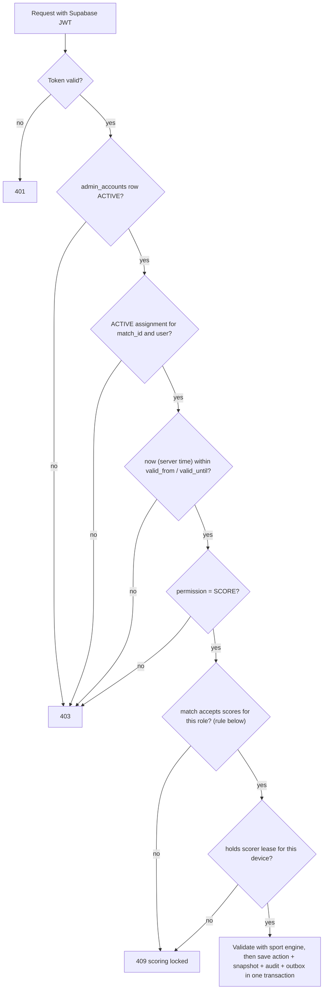
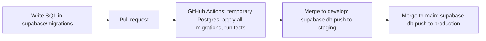

# Architecture

## Current implementation — 9 October 2026

The first application feature is a React + Vite JavaScript frontend in `frontend/`, managed through a root npm workspace and committed lockfile. React Router registers the homepage and reserved future sport/tournament destinations. No Express server, Supabase project/connection, authentication, scoring engine, Socket.IO or Redis has been added. Those parts below describe the target application.

Current folders: `frontend/src/app/` (routes), `components/` (header/icons/native rail), `data/` (sport IDs), `features/home/` (hero/matrix/filter/composition), `features/matches/` and `features/tournaments/` (sections/cards/display fixtures), `features/sports/badminton/` (badminton page, cards, detail dialog and fixtures), `styles/` (visual tokens), `frontend/public/` (local assets/favicon), and `frontend/tests/` (browser integration checks). Component styles sit alongside components. Setup is in `doc/local-development.md`. Current integration contracts are in `doc/handoff.md`.

The homepage owns its selected-sport state and passes filtered display data to presentational match cards. It has no persistence or network score feed. The shared native rail uses IntersectionObserver on stable card slots for partial-card emphasis; the canvas effect has lifecycle cleanup, a capped refresh rate, reduced-motion handling and offscreen/tab-hidden suspension. Build output is static files in `frontend/dist/`. Nested-route deployments require an index.html fallback.

GitHub Actions runs **frontend lint, build and Chromium browser tests** on Ubuntu, Windows and macOS. New frontend specs join the same suite. Extend test commands, jobs and path triggers when new application layers are implemented; follow the verification policy in `AGENTS.md`. Database/migration/deployment workflows below remain future work. Create future feature folders only when they contain actual implementation; do not add empty backend or database scaffolding for this milestone.

## Overview

Responsive website for tournaments and live sports scores. Tournament-specific public navigation is:

`Tournament list → Tournament → Enabled sport → Match → Scorecard`

The implemented homepage additionally has global sport links in its header and in-place sport filters for its live-match row. These are distinct controls; filters do not navigate.

Each tournament can enable any subset of football, volleyball, basketball, table tennis, lawn tennis, and badminton. Each sport has its own configurable match format and scoring rules.

Super Admins and Tournament Managers run tournaments across all enabled sports. Match Operators score only the specific matches they are assigned to. Spectators read public data without an account.

## Technology

- Frontend: React + Vite
- Backend: Node.js + Express
- Live updates: Socket.IO
- Database: hosted Supabase Postgres (separate staging and production projects); no Postgres runs on any team device
- Sign-in: Supabase Auth, invite-only, for Super Admins, Tournament Managers, and Match Operators
- Schema changes: SQL migrations in `supabase/migrations/`, applied by GitHub Actions
- Multi-server Socket.IO delivery: Redis adapter, only when running more than one backend instance

PostgreSQL is the source of truth. Socket.IO sends committed updates to connected viewers; it is not the score database.

## Repository structure

The following is the **target structure for the full application**, not a list of completed modules. The current frontend structure is recorded above and in the handoff.

Keep frontend and backend independent. Register frontend routes only in `frontend/src/app/App.jsx`. Put page UI in its feature folder and shared UI in `components/`. Put sport-specific UI and scoring behavior in that sport's module. Add folders only when they contain needed implementation. A future route extraction needs an agreed contract and a coordinated task first.

```text
frontend/
  src/
    app/                         # App.jsx: central route registration and app setup
    components/                  # reusable buttons, cards, tables, dialogs, status UI
    features/
      tournaments/               # tournament list, detail, and setup UI
      teams/                     # teams and roster management UI
      matches/                   # match list, detail, and result review UI
      access/                    # account invites, Assign Scorer, revoke/reassign
      operator/                  # My Matches and scoring entry for Match Operators
      sports/
        football/
          components/
          scoring/               # sport-specific score input and display
        volleyball/
          components/
          scoring/
        basketball/
          components/
          scoring/
        table-tennis/
          components/
          scoring/
        lawn-tennis/
          components/
          scoring/
        badminton/
          components/
          scoring/
    services/                    # HTTP API and Socket.IO clients
    state/                       # shared client state where needed

backend/
  src/
    app.js                       # Express app setup
    routes/                      # URL/method mapping to controllers
    controllers/                 # HTTP request/response handling
    middleware/                  # authentication, role/assignment authorization, validation, errors
    services/                    # tournament, team, match, assignment, review, and score workflows
    sports/
      football/                  # rules, score validation, result calculation
      volleyball/
      basketball/
      table-tennis/
      lawn-tennis/
      badminton/
    sockets/                     # Socket.IO setup, handshake auth, rooms, and live events
    database/                    # PostgreSQL connection and queries
    jobs/                        # outbox delivery and queued background work

supabase/
  config.toml                    # Supabase CLI project config
  migrations/                    # <timestamp>_name.sql, applied in order by CI
  seed.sql                       # fake data for CI/staging only

.github/
  workflows/                     # CI (test migrations) and release (db push) workflows

doc/                             # project documentation
```

Keep each backend sport module responsible for validating that sport's score actions and calculating its score/result. Shared services can call a sport module through a small common interface; avoid putting sport rules in controllers or UI components. Frontend sport folders contain sport-specific scoring controls and scorecards; reusable layout and form elements stay in `components/`.

## Roles and access

Core principle:

- **Authentication** answers "who is this person?" (Supabase Auth).
- **Role** answers "what can this type of user do?" (`admin_accounts.role`).
- **Match assignment** answers "which specific match can this person operate?" (`match_operator_assignments`).

Roles are stored explicitly as `SUPER_ADMIN`, `TOURNAMENT_MANAGER`, or `MATCH_OPERATOR`. Spectators have no account. Each account has exactly one role; Super Admin includes every Tournament Manager capability. Tournament Managers are global across all tournaments. There are no sport-scoped admin roles.

| Capability | Super Admin | Tournament Manager | Match Operator | Spectator |
| --- | --- | --- | --- | --- |
| View public tournaments, matches, scores | Yes | Yes | Yes | Yes |
| Create/edit tournaments, enable and configure sports | Yes | Yes | No | No |
| Create/edit teams and players | Yes | Yes | No | No |
| Create/edit matches and bracket assignments | Yes | Yes | No | No |
| Invite Match Operators | Yes | Yes | No | No |
| Invite/disable Tournament Managers and Super Admins | Yes | No | No | No |
| Assign, revoke, reassign scorers | Yes | Yes | No | No |
| View assigned match (private scoring view) | Yes, after self-assignment | Yes, after self-assignment | Assigned matches only | No |
| Start scoring, enter live scores, undo live actions, finish match, submit result | With active assignment | With active assignment | With active assignment | No |
| Approve/reject results | Yes, not own submission | Yes, not own submission | No | No |
| Override the no-self-approval rule (reason required) | Yes | No | No | No |
| Record exceptional outcomes (tie, forfeit, abandonment) | Yes | Yes | No | No |
| Correct an approved result (new version + new approval) | Yes | Yes | No | No |
| View audit history | Yes | Yes | No | No |

A manager or Super Admin who wants to score a match assigns themselves first; that assignment is audited like any other. Scoring always goes through the same assignment check.

### Scoring authorization chain

Every protected scoring HTTP request and Socket.IO command runs this chain server-side. Account and assignment state are read from the database on every request, not only at sign-in or from token claims, so a revocation takes effect on the next command. Hidden UI buttons are never the control.



An assignment is valid when its status is `ACTIVE`, its permission is `SCORE`, and server time is within its window. A null bound is open. The lower bound is inclusive; the upper bound is exclusive. With no `valid_until`, the assignment still cannot bypass a locked match or revocation.

Apply this match-state rule after the account, assignment, time-window and permission checks:

```js
const acceptsScores = match.status === 'LIVE' ||
  (match.status === 'REJECTED' &&
    (match.correction_route === 'OPERATOR' ||
      (match.correction_route === 'MANAGER' &&
        ['TOURNAMENT_MANAGER', 'SUPER_ADMIN'].includes(account.role))))
```

This is a planned backend contract, not implemented frontend code. `OPERATOR` correction uses the valid current assignment. `MANAGER` correction accepts only a Tournament Manager or Super Admin who assigned themselves. Match Operators remain locked out, even if an old assignment is still active. The device lease and sport validation remain required in both routes. All other match states reject score commands with 409.

For a manager correction, revoke the previous assignment and create the manager's self-assignment in one audited transaction. Keep one active assignment per match. Record the correction reason and actions, then require resubmission and a new review. Do not let a manager bypass the common scoring authorization chain.

Non-scoring privileged requests (tournament, team, match, assignment, review, account management) check token → active account → required role.

### Operator invitation

1. A Tournament Manager selects a match and chooses **Assign Scorer**.
2. The manager enters the operator's email and an optional time window.
3. If no account exists, the backend calls Supabase `auth.admin.inviteUserByEmail` with the secret key (server-side only) and creates an `admin_accounts` row with role `MATCH_OPERATOR`. It then creates the assignment row. Both are audited.
4. The operator receives the invite and signs in through Supabase Auth.
5. The backend verifies the active assignment on each request.
6. The operator sees only assigned matches.

Example: Football SF1 → Rahul → `SCORE` → 09:30–12:30.

Managers can invite `MATCH_OPERATOR` accounts only. Only a Super Admin creates Tournament Managers and Super Admins. Ending a match never deletes the user account; only the assignment expires or is revoked.

## Main backend request flow

1. A route sends the request to a controller.
2. Middleware verifies the Supabase JWT, loads the `admin_accounts` row, and checks the required role. Scoring commands also run the full assignment chain above. Request data is validated.
3. The service applies tournament/match workflow and calls the appropriate sport module for scoring rules.
4. The database transaction saves the score action, updated match state, audit entry, and live-update outbox record.
5. After commit, Socket.IO broadcasts the public update to the match/tournament room.

Public routes are read-only and need no account.

## Tournament, bracket, and result rules

- A tournament stores its enabled sports and each sport's validated format/scoring configuration.
- Each tournament sport has exactly two semifinal matches and one final. A Tournament Manager or Super Admin assigns teams to the semifinal sides.
- A semifinal winner advances to the final only after that semifinal result is approved.
- Custom matches are separate from the bracket and never advance bracket slots.
- Result states: `LIVE → PENDING_APPROVAL → APPROVED/FINAL`, or `PENDING_APPROVAL → REJECTED/CORRECTION`. Live score updates can be visible before approval, but only approved results are final.
- The assigned operator submits the result. A Tournament Manager or Super Admin reviews it. The reviewer must differ from the submitter, whatever their role. A Super Admin can override this only with a recorded reason; the override is audited.
- On rejection, the reviewer records a reason and chooses `OPERATOR` or `MANAGER` correction. `OPERATOR` reopens the current scorer's valid assignment until resubmission. `MANAGER` keeps Match Operators locked out and requires a manager or Super Admin self-assignment. Apply the role-aware match-state rule above.
- Approved results are locked. A correction to an approved result creates a new audited result version and requires another approval.
- An approval records the reviewer, time, result version, and decision.

## Main data records

- `tournaments`: name, dates, status, and event details.
- `tournament_sports`: enabled sport, format/rules configuration, configuration version, and standings options.
- `teams`: teams scoped to a tournament sport.
- `roster_players`: player entries scoped to a sport team; display name, branch/year, captain marker, optional jersey number and active state.
- `match_roster`: selected `roster_players` for a match, with active/substitute state.
- `matches`: participants, schedule, sport configuration snapshot, status, result, and bracket/custom type.
- `bracket_slots`: the two semifinal assignments and final slots linked to approved semifinal winners.
- `score_actions`: ordered, auditable sport-specific scoring events, including linked reversal actions for undo/correction.
- `match_snapshots` and `sport_standings`: derived current match and standings views.
- `admin_accounts`: Supabase Auth user ID, `role` (`SUPER_ADMIN` | `TOURNAMENT_MANAGER` | `MATCH_OPERATOR`), `status` (`ACTIVE` | `DISABLED`), `invited_by`, timestamps. No `is_admin` flag.
- `match_operator_assignments`:
  - `id`, `match_id`, `user_id`, `assigned_by`
  - `permission`: `'SCORE'` only (default)
  - `valid_from`, `valid_until`: both nullable; check `valid_until > valid_from` when both are set
  - `status`: `ACTIVE` | `REVOKED` only; "expired" is derived from time and never stored
  - `created_at`, `revoked_at`, `revoked_by`, `revoke_reason`
  - partial unique index on `match_id` where `status = 'ACTIVE'` (one active operator per match)
  - reassignment revokes the old row and inserts a new one in one audited transaction
- `scorer_leases`: the one active scoring device/session for a match. The assignment says **who** may score; the lease says **which device** is scoring now, preventing the same operator scoring from two tabs.
- `match_result_reviews`: result version, `submitted_by`, `reviewed_by`, `decision`, `reason`, `correction_route` (`OPERATOR` | `MANAGER`), `self_approval_override` (boolean), `override_reason`. Check: `reviewed_by <> submitted_by` unless `self_approval_override` is true with a non-empty `override_reason`.
- `admin_audit_log`: actor, action, entity, time, request ID, before/after summary, and reason. Covers account changes, assignments, revocations, reassignments, self-assignments, reviews, overrides, and corrections.
- `outbox_events`: committed changes waiting to be broadcast.

These are planned record names, not existing database tables. Use `roster_players` as the canonical player table name; do not create a second `players` table for the same records. Use database constraints for relationships and uniqueness. Save the sport configuration version with each match so later settings do not alter a live match.

Before backend work, agree the task's routes, payloads, statuses, authorization and error cases in these shared docs. Record unresolved decisions in `memory.md` and block the dependent task in `tasks.md`. The selected stack is a plan; it does not prove that the service, schema or capacity exists.

## Database hosting and migrations

No Postgres runs on any team device, including when the schema changes. All environments are hosted Supabase projects.

- **Environments:** one Supabase project for staging and one for production.
- **Migrations:** create files with `supabase migration new <name>` in `supabase/migrations/<timestamp>_name.sql`. Supabase records applied migrations in `supabase_migrations.schema_migrations`; `supabase db push` applies only pending files, in timestamp order.
- **Golden rule:** never change the remote schema through the Supabase Dashboard SQL or Table editors. That bypasses migration history and breaks `db push` (recovery needs `supabase migration repair` or `supabase db pull`).
- **Testing without a local database:** Supabase's local stack needs Docker, so it is not used. CI applies every migration to a throwaway Postgres on the GitHub Actions runner (service container or Supabase CLI on the runner), runs integration tests, and discards it.
- **Deploying:** only GitHub Actions runs `supabase db push`: merge to `develop` deploys to staging, merge to `main` deploys to production. Required repository secrets: `SUPABASE_ACCESS_TOKEN` (scoped to these projects) plus the database password and project ID for each environment.
- **Seed data:** `supabase/seed.sql` holds clearly fake data for CI and staging only; never seed production.



### Backend connection

- The long-running Node backend connects through the Supabase shared pooler in **session mode** (`aws-[index]-[region].pooler.supabase.com:5432`, user `postgres.[project-ref]`), which is IPv4. Copy the host from the Dashboard **Connect** dialog; it cannot be derived from the region.
- Direct connections (`db.[project-ref].supabase.co:5432`) are IPv6-only unless the paid IPv4 add-on is enabled. Migrations run by the CLI use the direct path.
- Avoid transaction mode (port 6543) for this backend: it does not support prepared statements, LISTEN/NOTIFY, or session state, which the outbox worker may rely on.
- Use `sslmode=require`, or `verify-full` with the downloaded server root certificate.

### Supabase security setup

- All data access goes through Express. Enable RLS on every table in the `public` schema with **no policies** (deny-all), so the Data API exposed with the publishable key returns nothing; alternatively disable Data API exposure of the schema.
- Use the new `sb_publishable_...` / `sb_secret_...` keys rather than legacy `anon`/`service_role`. The secret key stays on the backend only.
- Disable public sign-ups. Configure a custom SMTP provider (for example Resend, AWS SES, Postmark, Brevo) for invite emails: the built-in SMTP only delivers to project team members at about 2 messages/hour. Custom SMTP starts at 30 messages/hour and can be raised under Rate Limits. Set up SPF, DKIM, and DMARC for the sender domain.
- Use asymmetric JWT signing keys (ES256) so Express verifies tokens locally with `supabase.auth.getClaims()` or the JWKS endpoint. Public keys can be cached up to about 20 minutes, which is another reason account and assignment state is checked in the database on every request.

### Plan and hosting decisions (open)

- Supabase Free projects pause after 1 week of inactivity and have no automatic backups (500 MB database, 1-day logs). Pro never pauses and keeps 7 days of backups (8 GB disk). Choose Pro at least for the event period, or Free with the project unpaused before the event and scheduled `pg_dump` backups from CI.
- The Express + Socket.IO backend needs a long-running host while events run; it can be stopped between events. The frontend is static files on a CDN. The backend host is not yet chosen.

## Live updates and offline scoring

- Viewers load an HTTP snapshot, then subscribe to the relevant match or tournament Socket.IO room.
- Broadcast only public fields. Account identities, assignments, audit details, and private roster data are not sent to public rooms.
- Publish from the database outbox after transaction commit. On reconnect or a missed update, fetch a fresh snapshot from PostgreSQL-backed APIs.
- While a match is `LIVE`, the assigned operator can undo or correct as many times as needed, with no extra permission and no reason prompt. Each undo is stored as a linked reversal action with actor and server time; accepted actions are never erased. Live undos show no public correction marker. Corrections after submission or approval require a reason and show the public correction marker.
- The operator downloads the current match snapshot, stores actions locally when offline, sends them in order after reconnect, and retries with the same action ID to prevent duplicate scoring.
- The server validates each synced action against the operator's assignment and the score sequence, using **server receipt time** (the device clock is untrusted). If actions arrive after `valid_until` or after the assignment was revoked, sync pauses and a manager either extends the window or resolves the conflict.
- Mark offline actions as pending until the server confirms them. Pause sync and request manager resolution if match state or score sequence conflicts.
- One primary scoring device per match, enforced by `scorer_leases`.
- Use Redis only if multiple backend instances need to share Socket.IO room broadcasts. A single backend instance needs no Redis adapter.

## Security basics

- Spectators view public tournament and match data without signing in; they cannot change data.
- Privileged users sign in through invite-only Supabase Auth. Every protected request checks the token, loads the account from the database, and checks its role; scoring commands also run the full assignment chain.
- An operator attempting to score or open the private view of an unassigned match receives 403 Forbidden. A locked match returns 409.
- Managers can invite Match Operators only; only Super Admins create managers and Super Admins.
- Socket.IO scoring commands authenticate at the handshake and re-run the authorization chain per command; room membership alone grants nothing.
- Keep database credentials, the Supabase secret key, and SMTP credentials on the backend.
- Validate input on the backend, use HTTPS/WSS in deployed environments, and audit account changes, assignments, revocations, reassignments, overrides, result reviews, and corrections.
