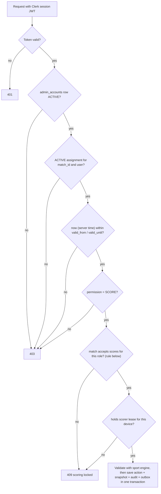
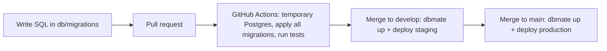

# Architecture

## Current implementation — 24 October 2026

The application has three parts:

- A React + Vite JavaScript frontend in `frontend/`, managed through a root npm workspace and a committed lockfile. React Router registers the homepage, six sport pages, the public tournament pages and the lazy staff area. The stack was confirmed on 11 October 2026; see [memory.md](memory.md#backend-and-hosting-decisions--11-october-2026).
- The `backend/` Worker: Hono API, `MatchRoom` live rooms, Clerk sign-in, assignments, leases, real scoring with frozen presets or custom formats and operator final confirmation, the outbox sweep, and the manager and Super Admin API. The `db/` migrations hold the schema. Published state: [tasks.md](tasks.md#current-task-claims).
- `shared/`: the pure scoring calculations (`scoring.mjs`) and the Event_Time_Zone (`time.mjs`), used by the Worker and the frontend.

Implemented management: tournament, sport, Default_Format, Sport_Manager, team and match setup, scorer assignment and Super Admin staff management ([Staff roles and manager console](#staff-roles-and-manager-console)). Not implemented: validated rosters, bracket advancement and standings. Manager result review is superseded. Sections below that describe these parts are the target design.

Current folders: `frontend/src/app/` (routes), `components/` (header/icons/native rail), `data/` (sport IDs), `features/home/` (hero/matrix/filter/composition), `features/matches/` (live cards), `features/tournaments/` (public tournament pages, cards, Venue_Library, display fixtures), `features/sports/` (shared sport page, sections, cards, dialog, calendar, fixture registry and one fixture folder per sport), `features/auth/` (lazy Clerk area and role gate), `features/staff/` (shared staff components), `features/manage/` and `features/admin/` (staff screens), `features/operator/` (My Matches and Score console), `features/legal/` (privacy), `services/` (HTTP and live clients), `styles/` (visual tokens), `frontend/public/` (local assets/favicon), and `frontend/tests/` (browser integration checks). Component styles sit alongside components. Setup is in `doc/local-development.md`. Current integration contracts are in `doc/handoff.md`.

The homepage owns its selected-sport state and passes filtered data to presentational match cards. With `VITE_API_BASE` it subscribes to the home room; without it, it uses display fixtures. The shared native rail uses IntersectionObserver on stable card slots for partial-card emphasis; the canvas effect has lifecycle cleanup, a capped refresh rate, reduced-motion handling and offscreen/tab-hidden suspension. Build output is static files in `frontend/dist/`. Nested-route deployments require an index.html fallback.

GitHub Actions runs **frontend lint, build and browser tests** on Ubuntu, Windows and macOS: Chromium and an emulated Pixel on all three, plus Firefox, WebKit and emulated iPhone and iPad on Ubuntu and macOS. New frontend specs join the same suite. Extend test commands, jobs and path triggers when new application layers are implemented; follow the verification policy in `AGENTS.md`. Backend CI, deploy, backup and bootstrap workflows are described in [Database hosting and migrations](#database-hosting-and-migrations). Create future feature folders only when they contain actual implementation; do not add empty backend or database scaffolding for this milestone.

## Overview

Responsive website for tournaments and live sports scores. Tournament-specific public navigation is:

`Tournament list → Tournament → Enabled sport → Match → Scorecard`

The implemented homepage additionally has global sport links in its header and in-place sport filters for its live-match row. These are distinct controls; filters do not navigate.

Each tournament can enable any subset of football, volleyball, basketball, table tennis, lawn tennis, and badminton. Each sport has its own configurable match format and scoring rules.

Super Admins run every tournament. Tournament Managers run only the tournaments and tournament sports in their Manager_Scope ([Manager scope](#manager-scope)). Match Operators (display name "Match Scorer") score only the specific matches they are assigned to. Spectators read public data without an account.

## Technology

- Frontend: React + Vite (JavaScript), served as Cloudflare Workers static assets with the SPA fallback
- API: one Cloudflare Worker with Hono (JavaScript); staff commands, including scoring, use HTTPS
- Live updates: SQLite-backed Durable Objects with the WebSocket Hibernation API; one room per match and one `home` room; viewer sockets are receive-only
- Database: Neon Postgres (separate staging and production projects); an optional disposable local database is used only for tests
- Database connection: Cloudflare Hyperdrive with the `pg` driver; a cached configuration for public reads and an uncached one for everything else
- Sign-in: Clerk. Anyone can sign up with a verified email or Google; staff roles come only from invitations recorded in our database
- Schema changes: plain SQL migrations in `db/migrations/`, applied with `dbmate` by GitHub Actions only

PostgreSQL is the source of truth. Durable Object rooms send committed updates to connected viewers; they are not the score database.

## Repository structure

The following is the **target structure for the full application**, not a list of completed modules. The current frontend structure is recorded above and in the handoff.

Keep frontend and backend independent. Register frontend routes only in `frontend/src/app/App.jsx`. Put page UI in its feature folder and shared UI in `components/`. Put sport-specific UI and scoring behavior in that sport's module. Add folders only when they contain needed implementation. A future route extraction needs an agreed contract and a coordinated task first.

```text
frontend/
  src/
    app/                         # App.jsx: central route registration and app setup
    components/                  # reusable buttons, cards, tables, dialogs, status UI
    features/
      tournaments/               # tournament list, detail, and setup UI
      teams/                     # teams and roster management UI
      matches/                   # match list and detail UI
      access/                    # account invites, Assign Scorer, revoke/reassign
      operator/                  # My Matches and scoring entry for Match Operators
      sports/
        football/
          components/
          scoring/               # sport-specific score input and display
        volleyball/
          components/
          scoring/
        basketball/
          components/
          scoring/
        table-tennis/
          components/
          scoring/
        lawn-tennis/
          components/
          scoring/
        badminton/
          components/
          scoring/
    services/                    # HTTP API and live WebSocket clients
    state/                       # shared client state where needed

backend/
  wrangler.jsonc                 # Worker, Durable Object, Hyperdrive, cron and environment config
  src/
    index.js                     # Hono app, static assets, live-socket routing, scheduled handler
    http.js                      # request ID, error body, public field allow-lists
    auth.js                      # Clerk token check, account load, role checks
    scope.js                     # Manager_Scope decision, requireScope, list filters
    validate.js                  # field validation and the tournament status machine
    scoring.js                   # scoring authorization chain, match-state rule and START rule
    rooms.js                     # MatchRoom Durable Object (match rooms and the home room)
    outbox.js                    # outbox sweep
    db.js                        # Hyperdrive pools and transactions
    routes/                      # public, me, invites, accounts, admin, manage, assignments, leases, actions
    engines/                     # legacy Test_Engine registry; real calculations in shared/scoring.mjs
  scripts/                       # Super Admin bootstrap, smoke check
  test/

shared/
  scoring.mjs                    # pure sport calculations for the Worker and the frontend
  time.mjs                       # Event_Time_Zone: the only definition of the event zone

db/
  migrations/                    # <timestamp>_name.sql, applied in order by dbmate in CI
  seed/fake.sql                  # fake data for CI and staging only

.github/
  workflows/                     # frontend and backend CI, deploy, backup and bootstrap workflows

doc/                             # project documentation
```

Keep each backend sport module responsible for validating that sport's score actions and calculating its score/result. Shared services can call a sport module through a small common interface; avoid putting sport rules in route handlers or UI components. Frontend sport folders contain sport-specific scoring controls and scorecards; reusable layout and form elements stay in `components/`.

## Roles and access

Core principle:

- **Authentication** answers "who is this person?" (Clerk).
- **Role** answers "what can this type of user do?" (`admin_accounts.role`).
- **Match assignment** answers "which specific match can this person operate?" (`match_operator_assignments`).

Roles are stored explicitly as `SUPER_ADMIN`, `TOURNAMENT_MANAGER`, or `MATCH_OPERATOR` (display names Super Admin, Tournament Manager, Match Scorer). A Spectator needs no account. A signed-in account with no `admin_accounts` row, or with a `DISABLED` row, is a Viewer: it has exactly the Spectator column's rights. Each account has exactly one role; Super Admin includes every Tournament Manager capability. A Tournament Manager acts only inside their Manager_Scope ([Manager scope](#manager-scope)). Sport_Manager is a scope, not a role; there are no other roles.

| Capability | Super Admin | Tournament Manager | Match Operator | Spectator |
| --- | --- | --- | --- | --- |
| View public tournaments, matches, scores | Yes | Yes | Yes | Yes |
| Create a tournament (the creator becomes its owner) | Yes | Yes | No | No |
| Edit, change status, delete a tournament; add or remove its sports and Sport_Managers | Yes | Owner only | No | No |
| Set a sport's Default_Format; create/edit teams and matches of that sport | Yes | In scope | No | No |
| Invite Match Operators | Yes | Yes | No | No |
| Invite Tournament Managers and Super Admins; list staff, cancel invitations, disable, re-enable, change role, transfer tournament ownership ([Super Admin API](#super-admin-api)) | Yes | No | No | No |
| Assign, revoke, reassign scorers | Yes | In scope | No | No |
| View assigned match (private scoring view) | Yes, after self-assignment | Yes, after self-assignment | Assigned matches only | No |
| Start scoring, enter live scores, undo live actions, finish match, submit result | With active assignment | With active assignment | With active assignment | No |
| Confirm final score and permanently lock it | With active assignment | With active assignment | With active assignment | No |
| Record exceptional outcomes (tie, forfeit, abandonment) | Yes | Yes | No | No |
| Edit a finalized result | No | No | No | No |
| View audit history | Yes | Yes | No | No |

A manager or Super Admin who wants to score a match assigns themselves first; that assignment is audited like any other. Scoring always goes through the same assignment check.

### Scoring authorization chain

Every protected scoring HTTP command runs this chain server-side. Account and assignment state are read from the database on every request, not only at sign-in or from token claims, so a revocation takes effect on the next command. Hidden UI buttons are never the control.



An assignment is valid when its status is `ACTIVE`, its permission is `SCORE`, and server time is within its window. A null bound is open. The lower bound is inclusive; the upper bound is exclusive. With no `valid_until`, the assignment still cannot bypass a locked match or revocation.

Apply this match-state rule after the account, assignment, time-window and permission checks:

```js
const acceptsScores = match.status === 'LIVE' ||
  (match.status === 'REJECTED' &&
    (match.correction_route === 'OPERATOR' ||
      (match.correction_route === 'MANAGER' &&
        ['TOURNAMENT_MANAGER', 'SUPER_ADMIN'].includes(account.role))))
```

The existing backend gate retains legacy `REJECTED` row compatibility. New scoring starts eligible `SCHEDULED` matches with `START` under the [START rule](#start-rule), and accepts later commands while `LIVE` with no date check. An exact accepted `FINALIZE` retry may replay a locked result after current authorization checks. New writes to final matches are refused. The new workflow never creates rejected or pending-review states and has no reopening endpoint.

Non-scoring privileged requests (tournament, team, match, assignment and account management) check token → active account → required role → Manager_Scope, in the [staff request order](#staff-request-order).

### Staff invitation

1. A Tournament Manager opens **Invite scorer**, or chooses "Invite as Match Scorer" when Assign scorer finds no account for an email. A Super Admin opens **Invite staff** for any role.
2. The backend checks the inviter's role: managers can invite `MATCH_OPERATOR` only.
3. The backend calls the Clerk Invitations API with the secret key (server-side only), then stores a pending invitation row and an audit row in one transaction. Clerk sends the email.
4. The invited person signs up or signs in through Clerk with the same verified email, by email or Google.
5. `/start` calls `POST /api/invites/accept`. The backend matches the verified email to the pending invitation and creates the `admin_accounts` row with the invited role, the invitation email and the Clerk name, with an audit row.
6. For a Match Scorer, the manager assigns the match by email (audited). The backend verifies the active assignment on each request, and the scorer sees only assigned matches.

Example: Football SF1 → `rahul@example.test` → `SCORE`. Managers set no time window ([Assignments](#assignments-and-the-operator-list)).

Only a Super Admin creates Tournament Managers and Super Admins. Sign-up without an invitation gives only the Viewer role. Ending a match never deletes the user account; only the assignment expires or is revoked.

## Main backend request flow

1. A Hono route receives the request.
2. Middleware verifies the Clerk session JWT, loads the `admin_accounts` row, and checks the required role. Request data is validated. Manager requests then check the Manager_Scope inside the transaction ([staff request order](#staff-request-order)); scoring commands run the full assignment chain above.
3. The service applies tournament/match workflow and calls the appropriate sport module for scoring rules.
4. The database transaction saves the score action, updated match state, audit entry, and live-update outbox record.
5. After commit, the Worker publishes the public snapshot to the match room and the `home` room. A cron sweep resends any undelivered outbox event.

Public routes are read-only and need no account.

## Tournament, bracket, and result rules

- A tournament stores its enabled sports and each sport's validated format/scoring configuration.
- Each tournament sport has at most one match per stage SF1, SF2 and FINAL (Bracket_Matches, stored kind `BRACKET`; 409 `STAGE_TAKEN` on a second one). A manager in scope sets the sides of each one; the sides of a FINAL are optional.
- Target rule, not implemented: a semifinal winner advances to the final only after that semifinal result is final. Until bracket advancement exists, the manager sets the FINAL sides by hand.
- A match with no stage is a Regular_Match (stored kind `CUSTOM`, shown as "Match"; the UI never says "custom"). It is public with its tournament and never advances the bracket.
- Current result flow: eligible `SCHEDULED → LIVE → APPROVED`. The assigned operator chooses and freezes the format at start, enters scores, corrects live mistakes, then confirms the computed final result. Confirmation immediately publishes and locks it. There is no separate review or post-final edit endpoint. See [rules.md](rules.md#6-score-corrections-and-final-results).
- Legacy `PENDING_APPROVAL` and `REJECTED` rows remain readable. They are not targets of this new workflow.

## Main data records

Existing tables (`db/migrations/`, six files):

- `tournaments`: `slug` (lower-case words and digits with hyphens, always with a letter, so it never looks like an ID), name, `starts_on`/`ends_on`, `status` (`DRAFT` | `ONGOING` | `COMPLETED` | `ARCHIVED`, [statuses](#tournament-statuses-and-phases)), venue, description, `image_key` (a Venue_Library key or NULL) and `owner_account_id` (NOT NULL; the Tournament_Owner).
- `tournament_sports`: one enabled sport per tournament (unique). `config` `{ format }` holds the Default_Format; `{}` means the Official_Preset. `config_version` increases by 1 on each changed save.
- `tournament_sport_managers`: `(tournament_sport_id, account_id)` primary key, `added_by`, `created_at`, an index on `account_id`. One row makes a Tournament_Manager a Sport_Manager of that sport.
- `teams`: Side_Records of one tournament sport. `label` is the name (unique per tournament sport ignoring case and outer spaces, index `teams_unique_name`); `branch` and `year` are optional; `year` is the college year, 1 to 4 (1st to 4th year), check `teams_year` from `20261023090000_team_college_year.sql`; `players` jsonb holds optional Player_Entries `[{ name, jersey?, captain? }]`, at most 30. See [Why `teams.players`](#why-teamsplayers).
- `matches`: two optional sides, `scheduled_at`, venue, `status` (`SCHEDULED` | `LIVE` | `APPROVED`, plus legacy `PENDING_APPROVAL` and `REJECTED`), the frozen `config_snapshot` and `config_version`, and `kind` (`BRACKET` with a stage SF1, SF2 or FINAL, unique per tournament sport; `CUSTOM` with no stage for a Regular_Match).
- `score_actions`: ordered, auditable sport-specific scoring events, including linked reversal actions for undo/correction.
- `match_snapshots`: the derived current public snapshot of a match.
- `admin_accounts`: Clerk user ID, `role` (`SUPER_ADMIN` | `TOURNAMENT_MANAGER` | `MATCH_OPERATOR`), `status` (`ACTIVE` | `DISABLED`), `invited_by`, `email` (lower case; unique among ACTIVE rows, index `one_active_account_email`), `name`, timestamps. No `is_admin` flag. `email` and `name` are stored at invitation acceptance.
- `staff_invitations`: invited email, role, status (`PENDING` | `ACCEPTED` | `REVOKED`), expiry (7 days), inviter and the Clerk invitation ID; one PENDING row per email.
- `match_operator_assignments`:
  - `id`, `match_id`, `account_id`, `assigned_by`
  - `permission`: `'SCORE'` only (default)
  - `valid_from`, `valid_until`: both nullable; check `valid_until > valid_from` when both are set
  - `status`: `ACTIVE` | `REVOKED` only; "expired" is derived from time and never stored
  - `created_at`, `revoked_at`, `revoked_by`, `revoke_reason`
  - partial unique index on `match_id` where `status = 'ACTIVE'` (one active operator per match)
  - reassignment revokes the old row and inserts a new one in one audited transaction
- `scorer_leases`: the one active scoring device/session for a match. The assignment says **who** may score; the lease says **which device** is scoring now, preventing the same operator scoring from two tabs. `POST /api/matches/:id/lease { deviceId, takeover? }` gives GRANT or TAKEOVER (both reset `last_client_seq` to 0), KEEP for the holding device, or 409 `LEASE_HELD`. `DELETE /api/matches/:id/lease { deviceId? }` deletes only the caller's own lease, and with `deviceId` only when that device holds it (204, repeatable). The score console releases on leave (unmount; `pagehide` with `keepalive` and the cached token) only while this device holds the lease, and never clears its offline queue. The console uses `lease.lastClientSeq + 1` for a new action and preserves its wire number on retries within that lease, so a queue kept across a release, reload or takeover continues under the new lease; actions already accepted are marked synced from `GET /api/operator/matches/:id/scoring` before any send. Since 24 October 2026 the console scores only while this device holds the lease: controls stay off until the lease answers, it re-checks the lease every 15 s and when the tab is shown, and **Take over scoring** discards this device's unsent actions (IndexedDB first) and reloads the accepted score before scoring continues.
- `admin_audit_log`: actor, action, entity, time, request ID, before/after summary, and reason. Covers account changes, invitations, assignments, revocations, reassignments, self-assignments, tournament, sport, team and match changes, score reversals, match start and final confirmation ([audit actions](#audit-rows)).
- `outbox_events`: committed changes waiting to be broadcast.

Planned tables, not created yet:

- `roster_players`: validated player entries of a sport team; display name, branch/year, captain marker, optional jersey number and active state.
- `match_roster`: selected `roster_players` for a match, with active/substitute state.
- `bracket_slots`: final slots linked to the final semifinal winners.
- `sport_standings`: derived standings.

No `match_result_reviews` table exists; the manager-review proposal is superseded, so do not build review endpoints. Use `roster_players` as the canonical name for validated player records; do not create a second `players` table for them. Use database constraints for relationships and uniqueness. Save the sport configuration version with each match so later settings do not alter a live match.

### Why `teams.players`

Player_Entries are optional display data for managers. They are never public and nothing reads them for scoring, eligibility or statistics yet. A jsonb column on `teams` (array, at most 30 entries, validated by `validatePlayers` in `backend/src/validate.js`) stores them without two tables that no code reads. When validated rosters are scoped (eligibility, match squads, substitutes), they go into `roster_players` and `match_roster` through a migration; that change also decides how existing `teams.players` entries map to them.

Before backend work, agree the task's routes, payloads, statuses, authorization and error cases in these shared docs. Record unresolved decisions in `memory.md` and block the dependent task in `tasks.md`. The selected stack is a plan; it does not prove that the service, schema or capacity exists.

## Database hosting and migrations

Staging and production use hosted Neon projects. CI, or an optional disposable local Postgres 18 database, runs database tests. Hosted schema changes run only through CI.

- **Environments:** one Neon project for staging (`Campuscores-staging`) and one for production (`Campuscores-production`), region `aws-ap-southeast-1`, Postgres 18. The plan caps autoscaling at 0.5 CU; both projects are now set to a maximum of 2 CU (lower it in the Neon console). CI service containers and the backup client use the same major (18).
- **Migrations:** plain SQL files in `db/migrations/<timestamp>_name.sql`, applied in order with a pinned `dbmate`. `dbmate` records applied migrations in the database and applies only pending files.
- **Golden rule:** change a hosted schema only through a CI migration. Never edit it through the Neon console SQL editor.
- **Testing without a local database:** CI applies every migration to a throwaway Postgres service container on the GitHub Actions runner, runs integration tests, and discards it.
- **Deploying:** only GitHub Actions applies migrations and deploys the Worker: a push to `develop` deploys staging, a merged release pull request to `main` deploys production. Secrets live in GitHub Environments (`staging`, `production`).
- **Deploy workflow:** [`.github/workflows/deploy.yml`](../.github/workflows/deploy.yml) runs on push to `develop` (Environment `staging`) or `main` (Environment `production`). One run at a time per environment; a newer push waits and never cancels a running deploy. Order: `npm ci`; frontend lint; backend lint; backend tests against a throwaway Postgres with `REQUIRE_DB=1`; frontend Chromium and Pixel tests; `dbmate up` on the environment database; fake seed (staging only, and only when `SEED_STAGING` is `true`); `npm run build` with the environment `VITE_*` values; `wrangler deploy --env <env>` from `backend/`; the Smoke_Script [`backend/scripts/smoke.js`](../backend/scripts/smoke.js) against `VITE_API_BASE` (`GET /health` 200, `GET /api/tournaments` 200, first `/live/home` message within 10 s, `GET /api/me` 401 without a token; it exits 1 and names the failed check). Known limit: the smoke step runs seconds after `wrangler deploy`, before the custom-domain route can serve the new Worker. On production it can fail with `GET /health` 522 while the deploy is good; re-run the job or run `node backend/scripts/smoke.js <url>` after a minute. Any failed step stops the run, so a failed migration never deploys the Worker. Migrations must stay compatible with the running Worker (expand, deploy, then contract).
- **Per-environment settings** (set the same names in both GitHub Environments, with that environment's values):

  | Name | Kind | Value |
  | --- | --- | --- |
  | `DATABASE_URL` | Secret | Neon **direct** (unpooled) connection string with `sslmode=require` |
  | `CLOUDFLARE_API_TOKEN` | Secret | Cloudflare API token with Workers deploy rights for the account |
  | `CLOUDFLARE_ACCOUNT_ID` | Secret | Cloudflare account ID |
  | `VITE_API_BASE` | Variable | Public API base URL of that environment (public; sent to the browser) |
  | `VITE_CLERK_PUBLISHABLE_KEY` | Variable | Clerk publishable key of that environment's instance (public) |

  `CLERK_SECRET_KEY` and `CLERK_JWT_KEY` are Worker secrets; `CLERK_PUBLISHABLE_KEY`, `AUTHORIZED_PARTIES` and `INVITE_REDIRECT_URL` (the sign-up page URL in invitation emails) are Worker vars. The Worker reads them for staff routes ([Sign-in setup](#sign-in-setup)). The vars are set per environment in `backend/wrangler.jsonc`; set the secrets once per environment with `npx wrangler secret put <NAME> --env <env>`. They are never in the config or the deploy workflow.
- **Wrangler environments:** `env.staging` uses `workers_dev` and the Clerk development instance, and sets `ENABLE_TEST_ENGINE`. `env.production` sets `workers_dev: false`, one zone route on the custom domain, the Clerk production instance vars and no `ENABLE_TEST_ENGINE`. Each environment repeats its DO, Hyperdrive and cron bindings. `backend/test/node/wrangler-config.spec.js` checks this. Set the route's fail-closed request-limit mode in the Cloudflare dashboard ([Rate limiting](#rate-limiting-and-quota-failure)).
- **Environment addresses:** staging serves `https://thaparlympics-staging.bhatiaarnav05.workers.dev` (Clerk development instance); production serves `https://campuscores.live` through the zone route `campuscores.live/*` and a proxied `AAAA 100::` apex record (Clerk production instance; its DNS records stay DNS only). `www.campuscores.live` is not configured. The two environments deploy independently. Confirmed revisions and smoke results are in [tasks.md](tasks.md#current-task-claims). The production Clerk Worker secrets, the route fail-closed mode and the rate-limit rule are set outside source; Arnav confirmed them on 21 October 2026 ([tasks.md](tasks.md#follow-up-tasks) F7, F9).
- **Seed data:** `db/seed/fake.sql` holds clearly fake data for CI and staging only; never seed production.
- **Super Admin bootstrap:** [`.github/workflows/bootstrap.yml`](../.github/workflows/bootstrap.yml) (manual; inputs `environment`, `clerk_user_id`) runs [`backend/scripts/bootstrap-super-admin.js`](../backend/scripts/bootstrap-super-admin.js) with that environment's `DATABASE_URL`. In one locked transaction it creates one active `SUPER_ADMIN` and an audit row, or refuses and changes nothing when an active Super Admin exists. Only when `BOOTSTRAP_ENV` is exactly `staging` does the check ignore the fake seed accounts (`clerk_user_id` starting `test_`); production and any other value keep the strict check.
- **Backups:** [`.github/workflows/backup.yml`](../.github/workflows/backup.yml) runs nightly at 21:30 UTC (03:00 IST) and on manual dispatch, in GitHub Environment `production`. Neon Free keeps only 6 hours of restore history. Order: install `postgresql-client-18` from PGDG; fail unless the `pg_dump` and Neon server majors both equal `PG_MAJOR` (18, the Neon staging and production major; change it, and the `postgres:18` images, if Neon's major changes); `pg_dump --format=custom`; `gpg --symmetric --cipher-algo AES256` with the passphrase from a private file; delete the plaintext dump; upload only the `.gpg` file as artifact `production-backup-<run id>` (14-day retention); decrypt, `pg_restore --exit-on-error --no-owner --no-acl` into a throwaway `postgres:18` service; fail if any table created in `db/migrations` or `schema_migrations` is missing. Any failed step fails the run. Secrets in Environment `production`: `DATABASE_URL` (above) and `BACKUP_PASSPHRASE` (long random passphrase; store a copy outside GitHub, because GitHub cannot show it again and without it no backup can be decrypted). To restore: download the artifact, run `gpg --decrypt` with the passphrase, then `pg_restore` into a new Neon branch or project. The workflow is disabled in GitHub since 20 October 2026. It returns before launch with private R2 storage and its own environment ([memory.md](memory.md#public-repository-and-ci--20-october-2026)).



### Backend connection

- The Worker connects to Neon through Cloudflare Hyperdrive with the `pg` driver and SSL.
- **Cached configuration:** public read routes only.
- **Uncached configuration:** sign-in, roles, assignments, leases and every write. A cached read would delay a revocation.
- Browsers never connect to the database. All data access goes through the Worker.

### Public read API

Source: [`backend/src/routes/public.js`](../backend/src/routes/public.js). No authentication or Clerk call. Every caller gets the same public allow-list. Tournament list and detail use the uncached configuration; sport and match reads use the cached configuration.

- Public tournaments are `status IN ('ONGOING','COMPLETED')`. `DRAFT` and `ARCHIVED` tournaments, and every match of them, return 404. Every match of a public tournament is public, Regular_Matches included.
- `GET /api/tournaments` → `{ tournaments: [tournament] }`, latest start date first.
- `GET /api/tournaments/:key` → `{ tournament }` with `sports` (sport keys) and `matches` (no `snapshot`). `:key` is an ID or a slug; a slug always contains a letter, so the two never collide. A key that is neither returns 400 `BAD_REQUEST`.
- `GET /api/sports/:sport/matches` → `{ matches }`: that sport's matches across public tournaments, each with `tournamentName` and `tournamentSlug`. An unknown sport key returns 404.
- `GET /api/matches/:id` → `{ match }` with `snapshot` (the latest Match_Room snapshot data, or `null`).
- An ID is a positive integer without a leading zero, up to 18 digits. Otherwise 400 `BAD_REQUEST`. An unknown or non-public ID returns 404 `NOT_FOUND`.
- Every body and Room_Message goes through `toPublic(kind, obj)` in [`backend/src/http.js`](../backend/src/http.js). It copies only the allow-listed fields. Database IDs are strings; dates are `YYYY-MM-DD` text; times are ISO UTC.
  - `tournament`: `id`, `slug`, `name`, `startsOn`, `endsOn`, `status`, `phase`, `imageKey`, `venue`, `description`, `sports`, `matches`.
  - `match`: `id`, `tournamentId`, `tournamentName`, `tournamentSlug`, `sport`, `kind`, `stage`, `status`, `phase`, `scheduledAt`, `venue`, `seq`, `sides` (`[{ name }]`), `snapshot`.
  - `card` (Home_Room): `id`, `sport`, `status`, `competition`, `tournamentId`, `sides`, `score`, `clock`, `seq`, `periods`, `winner`, `format`, `finalizedAt`, `gamePoints`, `serve`, `events` ([handoff.md](handoff.md#home_room-data)).
  - `snapshot`: the Match_Room data ([handoff.md](handoff.md#match_room-data)).
  - No staff, owner, scope, assignment, branch, year or player field is public.
- `phase` is `upcoming`, `live` or `past`, computed in the Worker ([public phase clock](#event-time-zone-and-public-phase-clock)). `imageKey` is the stored `image_key`, else `VENUE_KEYS[(id − 1) mod 5]` (`field`, `stadium`, `court`, `tennis`, `track`), so one tournament always shows the same photograph.
- `loadScoringContext` in `scoring.js` reads the tournament ID and `routes/actions.js` puts it on each card as `tournamentId`, so a tournament sport page can apply a live card for a match that its cached read does not contain yet.
- Current limit: `snapshot` is `null` until the match has a `match_snapshots` row (its first accepted score action).

### Sign-in setup

- Clerk Free: open sign-up, required email verification, the suspicious-sign-up challenge on, and Google as the only social provider.
- The Worker verifies session tokens with `@clerk/backend` and an `authorizedParties` allow-list. Roles never come from token claims.
- Source: [`backend/src/auth.js`](../backend/src/auth.js). `clerkAuth` verifies the token locally with `CLERK_JWT_KEY` and checks `azp` against `AUTHORIZED_PARTIES` (comma-separated origins); no token or a bad token returns 401 `UNAUTHENTICATED`. `loadAccount` reads `admin_accounts` by Clerk user ID through the uncached configuration on every request. `requireRole('staff' | 'manager' | 'superAdmin')` returns 403 `NOT_STAFF`, `ACCOUNT_DISABLED` or `ROLE_FORBIDDEN`. A missing Clerk setting returns 500, so a misconfigured Worker never grants access.
- `GET /api/me` (signed in) → `{ role, status }` for an `ACTIVE` staff account, else `{ role: 'VIEWER' }` (no row or `DISABLED`).
- `POST /api/invites { email, role }` (manager or above; [`routes/invites.js`](../backend/src/routes/invites.js)) → 201 `{ invitation: { id, email, role, status, expiresAt } }`. The email is stored in lower case and expires after 7 days. A role the caller cannot invite returns 403 `ROLE_FORBIDDEN`; a bad email 400; an unexpired pending invitation for that email 409 `INVITE_PENDING`; an ACTIVE staff account with that email 409 `STAFF_EXISTS`; a DISABLED one whose Clerk user still exists 409 `STAFF_DISABLED` (re-enable it instead; a deleted Clerk user allows a new invitation). These checks run before Clerk, so no email is sent. The Clerk invitation (redirect `INVITE_REDIRECT_URL`) is created first; a Clerk failure returns 502 `CLERK_UNAVAILABLE` and stores no row. If the database step then fails, the Clerk invitation is revoked (best effort) and the call returns 500.
- `POST /api/invites/accept` (signed in, no staff role needed) → `{ role, status }`. It matches the caller's verified Clerk emails to the oldest pending, unexpired invitation and creates the account with the invited role, `invited_by`, `email` and `name` in one transaction. No match returns 404 `INVITE_NOT_FOUND`; a caller who already has an account (also a disabled one) gets 409 `ACCOUNT_EXISTS` and nothing changes, except that an empty `email` and `name` are filled ([Super Admin API](#super-admin-api)).
- Account disable, enable, role change, staff lists, ownership transfer and invitation cancel are in the [Super Admin API](#super-admin-api).
- The Clerk secret key stays on the Worker as a secret. Only the publishable key reaches the browser.
- Staging uses a Clerk development instance on `workers.dev`. Clerk's shared Google credentials are acceptable there.
- **Production identity setup** (manual, outside source; do it before the first production deploy):
  - The Clerk production instance serves `campuscores.live`. Its publishable key (`pk_live_…`) is `CLERK_PUBLISHABLE_KEY` and `AUTHORIZED_PARTIES` is `https://campuscores.live` in `env.production.vars` of `backend/wrangler.jsonc`. Set the same publishable key as `VITE_CLERK_PUBLISHABLE_KEY` in GitHub Environment `production`. These values are public.
  - From `backend/`, set the two Worker secrets: `npx wrangler secret put CLERK_SECRET_KEY --env production` and `npx wrangler secret put CLERK_JWT_KEY --env production` (the instance's JWKS public key in PEM form). Never put them in config, the workflow or a GitHub secret.
  - Google sign-in: create our own OAuth client in Google Cloud and enter its client ID and secret in the Clerk production instance. Clerk does not supply shared Google credentials for a production instance. Use the redirect URI that Clerk shows.
  - Google consent screen: set the privacy policy URL to `https://campuscores.live/privacy` (the [`PrivacyPage`](../frontend/src/features/legal/PrivacyPage.jsx) route) and the home page to `https://campuscores.live`. Add `campuscores.live` as an authorized domain.
  - DNS: add the CNAME records that the Clerk production instance lists to the `campuscores.live` zone in Cloudflare. Set each one to **DNS only** (grey cloud), not proxied. A proxied Clerk record breaks Clerk's domain and certificate checks.
  - Current state (21 October 2026, confirmed by Arnav): the Google app is published (In production). The OAuth client "campuscores Production Login" has the Clerk production callback as its redirect URI, and Clerk Production uses these custom credentials. The 5 Clerk CNAME records are DNS only. The consent screen branding is set: home page, privacy URL, authorized domain and support email `bhatiaarnav05@gmail.com`. On campus Wi-Fi, Google sign-in and email sign-up with a code work on `https://campuscores.live/sign-in`, and `https://accounts.campuscores.live` loads (Cloudflare check, no block page). The Worker secrets work: a signed-in `GET /api/me` returned 200 with the database role ([tasks.md](tasks.md#follow-up-tasks) F7). The production Super Admin is bootstrapped (F11). The privacy owner and contact are recorded ([memory.md](memory.md#backend-open-items) item 4).
  - Campus DNS filter: the campus network uses a Fortinet DNS filter (block address `208.91.112.55`). On 21 October 2026 it returned the block address for some lookups of Clerk hostnames (`accounts.campuscores.live`; earlier, all Clerk names through `1.1.1.1`). Sign-in works now. Mitigation: ask campus IT to allow `campuscores.live` and `*.campuscores.live`, and recheck sign-in on campus Wi-Fi before the event ([memory.md](memory.md#backend-open-items) item 9).

### Plan and limits

Free-tier limits and the paid gate are recorded in [memory.md](memory.md#backend-and-hosting-decisions--11-october-2026). Design for daily request counts, not CPU:

- Viewers get the stored snapshot from the room on connect, so viewing never queries Neon.
- The outbox sweep skips Neon when no score was written in the last 15 minutes, so Neon can sleep.
- Public routes fail closed at the daily request cap. One rate-limit rule, counted per IP, covers API and sign-up paths, not live sockets. See [Rate limiting and quota failure](#rate-limiting-and-quota-failure).

### Rate limiting and quota failure

These are Cloudflare and Clerk dashboard settings for the production zone. They are not in source. Arnav confirmed the fail-closed mode, the rate-limit rule and the notifications below as applied on 21 October 2026 ([tasks.md](tasks.md#follow-up-tasks) F9).

- **One WAF rate-limit rule.** Cloudflare Free allows one rule on our own zone. Settings:
  - Expression: `starts_with(http.request.uri.path, "/api/") or starts_with(http.request.uri.path, "/sign-up")`.
  - Counting characteristic: IP address.
  - Period: 10 seconds. Block (mitigation timeout): 10 seconds.
  - Name: `api-flood-guard`. Threshold: 300 requests per 10 seconds. Action: Block. Decided 21 October 2026 ([memory.md](memory.md#backend-open-items) item 3).
  - Free plan limits: one rule, IP-only counting, the URI Path field only, 10-second period and mitigation timeout, no Log action.
  - Rationale: campus Wi-Fi and Indian mobile carrier-grade NAT (CGNAT) put many viewers and operators behind one IP address. A low threshold would block legitimate users and operators during a match. With IP-only counting, no single threshold can protect the 100,000/day Worker quota. Quota protection relies on the fail-closed route, cached public reads and manual usage checks on event days. This rule is a flood guard only.
  - Campus observation (21 October 2026, one laptop): campus traffic leaves through at least three public IPv4 addresses on different providers (`112.196.126.3`, `117.203.246.44`, `14.139.242.98`), spread per connection. There is no IPv6. Requests reached the Cloudflare data centers BOM and MRS. Cloudflare counts the limit per IP and per data center, so the campus load is split across several counters. This supports the threshold of 300 per 10 seconds.
  - Review Security analytics after the first event day. Lower the threshold if abuse appears.
  - The score console retries an HTTP 429 with backoff, like a 5xx, so a blocked operator does not need to resume sync by hand.
- **Not on `/live/`.** Campus Wi-Fi puts many viewers behind one IP address. A per-IP limit on live sockets would block them together. The expression above does not match `/live/`. Keep it that way.
- **Clerk Frontend API.** Clerk serves it on its own DNS-only subdomain `clerk.campuscores.live`, so our zone rule cannot reach it. Clerk Bot protection (the suspicious-sign-up challenge, [Sign-in setup](#sign-in-setup)) covers it.
- **Fail-closed route mode.** Only the production Worker route `campuscores.live/*` has this mode; staging uses `workers.dev` and has no route. The production route uses the request-limit failure mode **fail closed**. At the daily Worker request cap, requests get error 1027. They never bypass the Worker. API and live calls then fail, and the frontend shows that live scores are unavailable. Cloudflare documents that static assets keep loading at the cap; this is untested ([memory.md](memory.md#backend-open-items) item 7).
- **Notifications and usage checks.** The Cloudflare Platform Notifications list has no Workers or Durable Objects usage alert for the Free plan. "Usage Based Billing" needs a Professional plan or higher with pay-as-you-go ([Cloudflare docs](https://developers.cloudflare.com/notifications/notification-available/)). Do not expect an automatic email before a Free plan cap.
  - The account has "HTTP DDoS Attack Alert" (all plans) and "Incident alert" (Cloudflare Status).
  - On event days, check the Workers & Pages usage metrics by hand against the daily caps in [memory.md](memory.md#research-notes).
  - Workers Paid (the paid gate) adds usage-based alerts, if it is adopted.

## Staff roles and manager console

Implemented 22–23 October 2026 on `develop` ([tasks.md](tasks.md#current-task-claims)). This section is the contract for tournament ownership and sport scope, the Manager_Console, the Admin_Console, the tournament and match lifecycle and the START rule. Product behavior is in [prd.md](prd.md#staff-area). Decisions are in [memory.md](memory.md#staff-roles-and-manager-console--decisions). Source: `backend/src/{scope.js,validate.js,db.js}`, `backend/src/routes/{manage,admin,accounts,invites,assignments,me,public,actions}.js`, `shared/time.mjs`, `db/migrations/20261022090000_manager_scope.sql`, `frontend/src/features/{auth,staff,manage,admin,operator,tournaments}/`.

### Manager scope

- A Tournament_Owner (`tournaments.owner_account_id`) has scope over the tournament and all its Tournament_Sports. The creator becomes the owner. Only a Super_Admin transfers ownership.
- A Sport_Manager (a row in `tournament_sport_managers`) has scope over only that Tournament_Sport. The owner or a Super_Admin adds and removes Sport_Managers. The account must be an ACTIVE Tournament_Manager who is not the owner and not already on that sport; every other email gets the one 400 `MANAGER_NOT_ELIGIBLE` message, so the reply reveals nothing about other accounts.
- A Super_Admin has scope over everything. A Match_Scorer has no Manager_Scope and keeps the `SCORE` permission only.
- `scope.js` decides it: `scopeDecision` (pure), `requireScope(tx, account, target)` (403 `SCOPE_FORBIDDEN`) and `scopeFilter` for list queries. Target level: details, status, delete, sports, Sport_Managers and photograph are tournament level (owner only); Default_Format, teams, matches and Assignments are sport level (owner or that sport's Sport_Manager).
- Removing a Sport_Manager keeps the manager's ACTIVE Assignments. A disable or role change deletes the account's Sport_Manager rows ([Super Admin API](#super-admin-api)).

### Tournament statuses and phases

| Status | Public | Allowed changes (`TRANSITIONS` in `validate.js`) |
| --- | --- | --- |
| `DRAFT` (private setup) | No | → `ONGOING` ("Publish"; 409 `NO_SPORTS` without a sport) |
| `ONGOING` | Yes | → `COMPLETED` (409 `LIVE_MATCHES` while a match is Live) |
| `COMPLETED` | Yes | → `ONGOING`, → `ARCHIVED` |
| `ARCHIVED` | No | → `COMPLETED` |

Any other pair returns 409 `STATUS_CHANGE_INVALID`. A Completed or Archived tournament refuses every change except a status change (409 `TOURNAMENT_LOCKED`), also for assignments. Only a Draft can be deleted (409 `NOT_DRAFT`). The migration renamed stored `PUBLISHED` to `ONGOING`.

Phases are derived, never stored ([`shared/time.mjs`](../shared/time.mjs)):

- Match_Phase: `live` (`LIVE`); `upcoming` (`SCHEDULED` before Match_Day_End); `past` (`APPROVED`, or `SCHEDULED` after Match_Day_End, which is Not_Scored). Staff labels: Live, Scheduled, Final, Not scored (`staffPhase` in `labels.js`).
- Tournament_Phase: `upcoming` (Ongoing, start date after today), `live` (Ongoing, today within the dates), `past` (Completed, or Ongoing with the end date before today). "Today" is the current India_Time date.
- Match_Day_End is the next Event_Time_Zone midnight after the scheduled time. Not_Scored needs no cron job and cannot drift.

### Event time zone and public phase clock

- `shared/time.mjs` is the one definition of the event zone: `EVENT_TIME_ZONE = { name: 'Asia/Kolkata', label: 'IST', offsetMinutes: 330 }`, with `istDate`, `matchDayEnd`, `utcToIst`, `istToUtc`, `timeText`, `matchPhase`, `tournamentPhase` and `needsScorer`. India_Time has a fixed offset and no daylight saving time, so plain arithmetic is exact. SQL gets the zone name as a parameter.
- Guard: [`backend/test/node/event-time-zone.spec.js`](../backend/test/node/event-time-zone.spec.js) scans `backend/src`, `backend/scripts`, `frontend/src` and `shared` (except `shared/time.mjs` and `sample*.js` Display_Fixtures). It fails on `Asia/Kolkata`, a `5:30` offset, `330`/`19800` or `IST` as a literal, and on `now()`, `current_date`, `current_timestamp` or `localtimestamp` in `backend/src/routes/public.js`.
- Public phase clock (confirmed by Arnav, 21 October 2026). Public reads use the cached Hyperdrive pool with no time function in the SQL; Hyperdrive does not cache a query that names `now()`. The Worker therefore computes every public `phase` from Worker_Time (`Date.now()`). No phase is stored or cached, and public responses get no HTTP or edge cache. The frontend groups by the returned `phase` and never reads device time for a phase.
- Staff reads, staff writes and START use database `now()`, so a scorer and the server agree on the India_Time day. Worker_Time and database time can differ by clock skew only.

### Staff request order

Every manager and Super Admin request runs on the uncached pool in this order:

1. `clerkAuth` → 401 `UNAUTHENTICATED`.
2. `loadAccount` + `requireRole('manager' | 'superAdmin')` → 403 `NOT_STAFF` (Viewer), `ACCOUNT_DISABLED`, `ROLE_FORBIDDEN`.
3. Parse IDs and body (`validate.js`) → 400 `BAD_REQUEST` with the message `<field>: <fix>` for the first invalid field. A malformed ID is 400.
4. In one `withTx`: lock and load the target → 404 `NOT_FOUND`.
5. `requireScope` → 403 `SCOPE_FORBIDDEN`.
6. State rules → 409 with a specific code.
7. The write and its Audit_Row in the same transaction.

Every refusal writes nothing. `backend/test/authz-matrix.spec.js` checks each endpoint for anonymous, invalid token, Viewer, DISABLED account, Match_Scorer, Tournament_Manager in and out of scope, owner and Super_Admin.

### Manager API

Source: [`routes/manage.js`](../backend/src/routes/manage.js), `requireRole('manager')`. "Owner" means Tournament_Owner or Super_Admin; "sport scope" means owner or a Sport_Manager of that sport. Staff rows carry ISO UTC `scheduledAt` plus India_Time `date` and `time` text.

| Method and path | Scope | Body | Success | Specific errors |
| --- | --- | --- | --- | --- |
| `GET /api/manage/home` | Rows in scope | — | `{ today, tournaments[], todayMatches: { live, scheduled, final, notScored }, needsScorer }`; each group `{ items (≤ 50), total }`; `needsScorer` covers the next 7 India_Time dates. A Super_Admin also gets `pendingInvitations` (count of PENDING invitations unexpired by database `now()`) | — |
| `GET /api/manage/tournaments` | In scope | — | `{ tournaments: [{ id, slug, name, status, startsOn, endsOn, imageKey, isOwner, sports[], owner?, sportManagers? }] }` by start date, then name. `owner: { accountId, name, email }` and `sportManagers: [{ sport, accountId, name, email }]` only on rows the caller owns (a Super_Admin owns every row here) | — |
| `POST /api/manage/tournaments` | Any manager | `{ name, startsOn, endsOn?, venue?, description? }` | 201 `{ tournament, isOwner, ownerId }`; status `DRAFT`, the caller is owner | 400 field |
| `GET /api/manage/tournaments/:slug` | In scope | — | `{ tournament, isOwner, nextStep, sports: [{ sport, defaultFormat, configVersion, teamCount, matchCount, managers? }] }`; a Sport_Manager gets only their sports | 404 |
| `PATCH /api/manage/tournaments/:slug` | Owner | Any of `name, startsOn, endsOn, venue, description, imageKey` | `{ tournament, isOwner, ownerId }` | 400 field; 409 `DATES_EXCLUDE_MATCHES` (message has the count), `TOURNAMENT_LOCKED` |
| `POST /api/manage/tournaments/:slug/status` | Owner | `{ status, reason? }` | `{ tournament, isOwner, ownerId }` | 409 `STATUS_CHANGE_INVALID`, `NO_SPORTS`, `LIVE_MATCHES` |
| `DELETE /api/manage/tournaments/:slug` | Super Admin only, any status | `{ reason? }` (required unless Draft) | `{ removed: { sports, teams, matches, assignments, sportManagers } }`; also deletes score actions, snapshots, outbox events and leases, then drops the home cards | 403 `ROLE_FORBIDDEN` (manager); 409 `REASON_REQUIRED` |
| `POST /api/manage/tournaments/:slug/sports` | Owner | `{ sport }` | 201 `{ sport, defaultFormat }` (the Official_Preset) | 400 unknown key; 409 `SPORT_EXISTS`, `TOURNAMENT_LOCKED` |
| `DELETE /api/manage/tournaments/:slug/sports/:sport` | Owner | — | `{ removed: { teams, sportManagers } }` | 409 `SPORT_HAS_MATCHES`, `TOURNAMENT_LOCKED` |
| `PUT /api/manage/tournaments/:slug/sports/:sport/format` | Sport scope | `{ format }` | `{ defaultFormat, configVersion, changed }`; an equal format writes nothing | 400 `validateFormat` message; 409 `TOURNAMENT_LOCKED` |
| `POST /api/manage/tournaments/:slug/sports/:sport/managers` | Owner | `{ email }` | 201 `{ manager: { accountId, name, email } }` | 400 `MANAGER_NOT_ELIGIBLE`; 409 `TOURNAMENT_LOCKED` |
| `DELETE /api/manage/tournaments/:slug/sports/:sport/managers/:accountId` | Owner | — | `{ removed: true }` | 404; 409 `TOURNAMENT_LOCKED` |
| `GET /api/manage/tournaments/:slug/sports/:sport/teams` | Sport scope | — | `{ teams: [{ id, name, branch, year, players, locked, used }] }` | — |
| `POST /api/manage/tournaments/:slug/sports/:sport/teams` | Sport scope | `{ name, branch?, year?, players? }` | 201 `{ team }` | 400 field; 409 `DUPLICATE_NAME`, `TOURNAMENT_LOCKED` |
| `PATCH /api/manage/teams/:id` | Sport scope | Team fields | `{ team }` | 409 `TEAM_IN_USE` (used by a Live, Final or Not_Scored match), `DUPLICATE_NAME`, `TOURNAMENT_LOCKED` |
| `DELETE /api/manage/teams/:id` | Sport scope | — | `{ removed: true }` | 409 `TEAM_IN_USE` (any match uses it), `TOURNAMENT_LOCKED` |
| `GET /api/manage/matches?tournament=&sport=&date=&phase=` | In scope | — | `{ matches[] (≤ 500), total }` by time, then ID; `phase` is `live`, `upcoming` or `past` | 400 bad filter |
| `POST /api/manage/matches` | Sport scope | `{ tournament, sport, date, time, stage?, sideA?, sideB?, venue? }` | 201 `{ match }`; `kind` `BRACKET` with a stage, else `CUSTOM` | 400 field; 409 `STAGE_TAKEN`, `TOURNAMENT_LOCKED` |
| `GET /api/manage/matches/:id` | Sport scope | — | `{ match }` with its Assignment and flags | 404 |
| `PATCH /api/manage/matches/:id` | Sport scope | Any of `date, time, stage, sideA, sideB, venue` | `{ match }` | 409 `MATCH_CLOSED` (Live, Final or Not_Scored), `STAGE_TAKEN`, `TOURNAMENT_LOCKED` |
| `DELETE /api/manage/matches/:id` | Super Admin only, any match state | `{ reason? }` (required when Live, Final, Not_Scored or scored) | `{ removed: true }`; deletes its assignments, lease, score actions, snapshot and outbox events, then drops its home card | 403 `ROLE_FORBIDDEN` (manager); 409 `REASON_REQUIRED`, `TOURNAMENT_LOCKED` |

Staff match row: `{ id, tournament: { slug, name, status }, sport, kind, stage, status, phase, label, scheduledAt, date, time, venue, sides: [{ id, name }], score, scorer: { name, email } | null, assignmentId, canEdit, canDelete, canAssign, canScore }`. The screens render no control that the flags or `isOwner` refuse.

Field rules (`validate.js`; the screens repeat them for on-blur checks):

| Form | Rules |
| --- | --- |
| Tournament | Name trimmed 1–120; start date `YYYY-MM-DD`; end date ≥ start (defaults to start); venue ≤ 200; description ≤ 1000; `imageKey` one of `field`, `stadium`, `court`, `tennis`, `track`, or empty for Automatic |
| Team | Name trimmed 1–120, unique per Tournament_Sport ignoring case and outer spaces; branch ≤ 120; year 1–4 (college year) or empty, error `year: Choose 1st, 2nd, 3rd or 4th year.`; ≤ 30 players; player name 1–120; jersey 0–99 and captain only for football, basketball and volleyball; at most 1 captain |
| Match | India_Time `date` and `time` (`YYYY-MM-DD`, `HH:MM`); date not before today and within the tournament dates; sides of the same Tournament_Sport and different; both sides required except for FINAL; venue ≤ 200; stage unique per Tournament_Sport |
| Email | Trimmed, lower-cased, ≤ 254, the invitation pattern |
| Reason | Required (non-empty after trim) for disable, reassign and revoke; optional elsewhere; ≤ 500 |

### Assignments and the operator list

Source: [`routes/assignments.js`](../backend/src/routes/assignments.js).

`POST /api/matches/:id/assignments` (`requireRole('manager')`) locks the match, then the tournament `FOR SHARE`, then runs `requireScope`. It accepts one target, checked in this order:

| Body | Result |
| --- | --- |
| `{ self: true, reason? }` | Assigns the caller; audit action `SELF_ASSIGNED` |
| `{ email, reason? }` | Trimmed and lower-cased. The caller's own ACTIVE email is a self assign. An ACTIVE `MATCH_OPERATOR` is assigned. Otherwise 400 with a message that starts `email:`: `INVITE_PENDING` (a pending, unexpired invitation), `NOT_A_SCORER` (any other account, also DISABLED) or `SCORER_NOT_FOUND` (no account) |
| `{ accountId, validFrom?, validUntil?, reason? }` | Legacy body, unchanged |

- The email resolves only after the scope check, so an out-of-scope caller learns nothing about accounts.
- A Final or Not_Scored match returns 409 `MATCH_CLOSED`; a Completed or Archived tournament 409 `TOURNAMENT_LOCKED`. A match that has a scorer needs `reason` (409 `REASON_REQUIRED`); then the reassign contract applies (revoke the old row and insert the new one in one audited transaction; 409 `ASSIGNMENT_CONFLICT` on a race).
- A new assignment has no window and removes the match's lease. Managers do not set Assignment windows: the frontend never sends `validFrom` or `validUntil`, and the API keeps accepting them for compatibility.
- `POST /api/assignments/:id/revoke { reason }` runs `requireScope` after the match lock and before the write.

`GET /api/operator/matches` (any staff role) lists the caller's ACTIVE Assignments. Each row has `status`, `correctionRoute`, `format`, `isToday`, `validNow` and:

- `canStart`: `true` only for a `SCHEDULED` match that passes `startDecision` with database `now()`.
- `startReason`: the `startDecision` code for a `SCHEDULED` match that cannot start, else `null`. A match with no `scheduledAt` gives `START_TOO_EARLY`.
- `notScored`: `true` for a `SCHEDULED` match after its Match_Day_End.
- `defaultFormat`: the Tournament_Sport Default_Format (`tournament_sports.config.format`), else the sport's Official_Preset.

### START rule

`startDecision({ now, scheduledAt, tournamentStatus })` in [`scoring.js`](../backend/src/scoring.js) accepts START only when the tournament is Ongoing and database time is at or after the scheduled time and before Match_Day_End. Otherwise it refuses, checked in this order: 409 `TOURNAMENT_NOT_ONGOING`; 403 `START_TOO_EARLY` (also for a match with no scheduled time); 409 `MATCH_DAY_OVER`.

- It runs only for START, after the account, assignment, window, permission and match-state checks of the [scoring chain](#scoring-authorization-chain) and before the lease check. Later commands of a Live match have no date check, also after Match_Day_End.
- A match not started by Match_Day_End is Not_Scored and can never start.
- At START, `matches.config_version` takes `tournament_sports.config_version`. When the tournament is not `ONGOING` or `COMPLETED`, the outbox event is marked `private` and `publishEvent` sends it to no Live_Room.

### Super Admin API

Every endpoint below is `clerkAuth` → `loadAccount` → `requireRole('superAdmin')`. A Tournament_Manager or Match_Scorer gets 403 `ROLE_FORBIDDEN`; a Viewer gets 403 `NOT_STAFF`. Source: [`routes/admin.js`](../backend/src/routes/admin.js), [`routes/accounts.js`](../backend/src/routes/accounts.js), [`routes/invites.js`](../backend/src/routes/invites.js).

| Endpoint | Body | Reply | Refusals |
| --- | --- | --- | --- |
| `GET /api/admin/staff?role=&status=&offset=` | — | `{ staff: [{ id, name, email, role, status, tournaments: [name] }], nextOffset }`: ACTIVE first, then email, then ID; 50 per page; `nextOffset` is `null` on the last page. `tournaments` lists the owned tournaments and those with a managed sport | 400 for an unknown `role` or `status` |
| `GET /api/admin/staff/:id` | — | `{ member: { id, name, email, role, status, owned: [{ slug, name }], sportScope: [{ tournament: { slug, name }, sport }], activeAssignments } }` | 404 |
| `POST /api/accounts/:id/disable` | `{ reason }` | `{ account: { id, status: 'DISABLED', revokedAssignmentIds } }` | 409 `REASON_REQUIRED`; then in order 404, 409 `ALREADY_DISABLED`, `LAST_SUPER_ADMIN`, `OWNER_TRANSFER_REQUIRED` |
| `POST /api/accounts/:id/enable` | `{ reason? }` | `{ account: { id, status: 'ACTIVE' } }`; the role stays; no Assignment, lease or scope is restored | 404; 409 `ALREADY_ACTIVE`; 409 `ACCOUNT_EXISTS` when another ACTIVE account now holds the email |
| `POST /api/accounts/:id/role` | `{ role, reason? }` | `{ account: { id, role, status }, revokedAssignmentIds }` | 400 unknown role; then in order 404, 409 `ACCOUNT_DISABLED`, 400 same role, 409 `LAST_SUPER_ADMIN`, `OWNER_TRANSFER_REQUIRED` |
| `POST /api/admin/tournaments/:slug/owner` | `{ email, reason? }` | `{ tournament: { slug, owner: { accountId, name, email } } }` | 404; 400 `email:` when the email is not an ACTIVE Tournament_Manager or is the current owner |
| `GET /api/admin/invitations?offset=` | — | `{ invitations: [{ id, email, role, invitedBy, expiresAt }], nextOffset }`: PENDING and unexpired by database `now()`, soonest expiry first, 50 per page | — |
| `POST /api/invites/:id/cancel` | `{ reason? }` | `{ invitation: { id, status: 'REVOKED' } }` | 404; 409 `INVITE_CLOSED`; 502 `CLERK_UNAVAILABLE` |

- Disable and role change revoke the account's ACTIVE Assignments and delete its `scorer_leases` and `tournament_sport_managers` rows in the same transaction.
- An ownership transfer deletes the new owner's Sport_Manager rows in that tournament. The previous owner keeps no scope.
- Invitation cancel reads the row first: missing is 404, closed or expired is 409 `INVITE_CLOSED`, with no Clerk call. It then calls Clerk `revokeInvitation` outside any transaction, so no row lock is held across the network call. A Clerk 404 counts as revoked. Any other Clerk failure is 502 `CLERK_UNAVAILABLE` and the row stays PENDING. Last, a conditional update closes the row only while it is still PENDING and unexpired; a concurrent accept or cancel that won gives 409 `INVITE_CLOSED`.

Other changed endpoints:

- `POST /api/invites/accept` stores `email` (the invitation email) and `name` (Clerk first and last name) on the new account. It also fills an empty `email` and `name` of the caller's existing account (for example the bootstrapped Super Admin) from the `users.getUser` call it already makes, so it adds no Clerk call.
- `DELETE /api/me` returns 403 `SCORER_ACCOUNT_MANAGED` for an ACTIVE Match Scorer (shared event logins; a Super Admin disables them) and 409 `OWNER_TRANSFER_REQUIRED` for a tournament owner, before Clerk is called. It treats `ALREADY_DISABLED` from a concurrent delete or disable as done and continues to the Clerk delete, like a retry.

### Lock order

Keep these orders in new code. A different order can deadlock or let a guard race.

- Match commands (edit, delete, assign, revoke, START): the match row `FOR UPDATE`, then the tournament `FOR SHARE`. START reads the tournament status under that lock, so a concurrent change to Completed cannot pass a match that is becoming Live. Match create has no match row yet; it locks the tournament `FOR SHARE`.
- Tournament status change and detail edit: the tournament `FOR UPDATE` only; they read matches without locks.
- Draft tournament delete: the tournament's matches `FOR UPDATE` in ID order, then the tournament `FOR UPDATE`.
- Sport, Default_Format, Sport_Manager and team create: the tournament `FOR UPDATE`, then the `tournament_sports` row `FOR UPDATE`. Team edit and delete lock the team row.
- Tournament, then account: the Sport_Manager add and the ownership transfer lock the tournament `FOR UPDATE`, then the account `FOR SHARE`.
- Tournament create locks only the caller's own account `FOR SHARE` and re-checks it. A concurrent disable or role change either commits first, so the share lock sees a non-eligible row and refuses, or waits and then sees the new tournament and refuses with 409 `OWNER_TRANSFER_REQUIRED`.
- `lockAccount` (in `accounts.js`, shared by disable, enable and role change) locks the target and every ACTIVE Super_Admin `FOR UPDATE` in ID order, so two concurrent requests cannot both remove the last ACTIVE Super_Admin (`backend/test/admin.spec.js` runs this race). Account rows are locked before any Assignment, lease or Sport_Manager row; these paths lock no match or tournament row.

### Audit rows

`audit(tx, { actorId, action, entity, entityId, requestId, before, after, reason })` in `backend/src/db.js` writes the Audit_Row inside the transaction; a failed insert aborts it and the client gets 500. Actions: `TOURNAMENT_CREATED`, `TOURNAMENT_UPDATED`, `TOURNAMENT_STATUS_CHANGED`, `TOURNAMENT_DELETED`, `OWNER_TRANSFERRED`, `SPORT_ADDED`, `SPORT_REMOVED`, `SPORT_FORMAT_CHANGED`, `SPORT_MANAGER_ADDED`, `SPORT_MANAGER_REMOVED`, `TEAM_CREATED`, `TEAM_UPDATED`, `TEAM_DELETED`, `MATCH_CREATED`, `MATCH_UPDATED`, `MATCH_DELETED`, `ASSIGNMENT_CREATED`, `SELF_ASSIGNED`, `ASSIGNMENT_REVOKED`, `ACCOUNT_DISABLED`, `ACCOUNT_ENABLED`, `ROLE_CHANGED`, `INVITE_CANCELLED`, plus the invitation, acceptance and scoring actions that existed before.

### Staff screens

- Router: `frontend/src/main.jsx` uses `createBrowserRouter([{ path: '*', element: <App /> }])` with `RouterProvider`, so `useBlocker` works for the unsaved-changes guard. Routes stay in [`App.jsx`](../frontend/src/app/App.jsx).
- Every account and staff route renders `AuthArea` with a `screen` key through `staff('<screen>')`. `AuthArea` is a lazy chunk, so public pages load no Clerk code. `SiteHeader` has no "My Matches" link.

| Path | Screen |
| --- | --- |
| `/sign-in` | Sign-in choice: "Continue as guest", "Sign in as Match Scorer", "Sign in as Tournament Manager". A signed-in user goes to the start screen |
| `/sign-in/scorer/*`, `/sign-in/manager/*`, `/sign-up/*` | Clerk `SignIn` or `SignUp` (`routing="path"`), then `/start` |
| `/start` | `POST /api/invites/accept` once per session (404 `INVITE_NOT_FOUND` and 409 `ACCOUNT_EXISTS` are ignored), then `GET /api/me`, then replace with the start screen of the role |
| `/operator/matches`, `/operator/matches/:matchId/score` | My Matches and Score console |
| `/manage`, `/manage/tournaments/new`, `/manage/tournaments/:slug`, `.../setup`, `.../setup/:step`, `.../details`, `.../sports/:sport`, `.../sports/:sport/teams` | Manager home, Guided_Setup (5 steps), Tournament overview, Tournament details, Sport setup, Teams |
| `/manage/matches`, `/manage/matches/new`, `/manage/matches/:matchId`, `/manage/matches/:matchId/scorer`, `/manage/invite` | Matches, Match editor, Assign scorer, Invite scorer |
| `/admin`, `/admin/tournaments`, `/admin/staff`, `/admin/staff/invite`, `/admin/staff/:accountId`, `/admin/invitations` | Admin home, All tournaments, Staff list, Invite staff, Staff member detail, Pending invitations |

- Role gate: `AuthArea` `SCREENS` lists each screen's title, allowed roles, current navigation item and page. `useMe` reads `GET /api/me` once per Staff_Area mount; the role comes only from there. While it loads, the screen shows a text status; a network error or 5xx shows "Try again"; a 401 shows the sign-in prompt; a role that the screen does not allow, `ROLE_FORBIDDEN` or `SCOPE_FORBIDDEN` shows "You do not have access to this page".
- Navigation (`STAFF_NAV` and `startScreen` in [`labels.js`](../frontend/src/features/staff/labels.js)); the first item is the start screen:
  - Match Scorer: My Matches · Account.
  - Tournament Manager: Home (`/manage`) · Matches · Invite scorer · Account.
  - Super Admin: Home (`/admin`) · Tournaments · Matches · Staff · Account.
- Containers: each screen is a presentational View plus a thin container (`frontend/src/features/manage/*Page.jsx`, `frontend/src/features/admin/*Page.jsx`). Shared hooks in `frontend/src/features/staff/`: `useStaffData` (one read on entry and one per "Try again"; no timer or poll), `useMutation` (one request per press), `useUnsavedGuard` (`useBlocker` plus `beforeunload`, with `ConfirmDialog`). `usePagedList` (admin) appends the next page on "Load more"; a failed page keeps the rows and offers "Try again".
- Errors: `messageFor` in `labels.js` maps each Error_Body code to one plain sentence and, for some codes, to a form field. A `BAD_REQUEST` message `<field>: <fix>` goes below that field. No code or request ID is shown. A 401 offers "Sign in again" through Clerk `openSignIn()` and keeps the values. Forms offer "Try again" after a 500, 502 or no response and resend the same values. `DialogRecovery` adds these controls inside a `ConfirmDialog`, and "Reload the page" after a 403 or 409 that means the item changed.
- Labels: a match with no stage shows "Match" (`stageLabel`); there is no custom match control. The Match editor offers stage SF1, SF2, FINAL or none. Times show in India_Time with the Event_Time_Zone label.
- `ConfirmDialog` (native modal): Cancel has `autofocus` before `showModal()`, so opening never focuses and blurs the Reason field. It cancels on a `close` event only when the dialog is closed at that moment, because a queued `close` of an earlier opening can arrive after a reopen.
- `StaffShell` focuses the `h1` on route entry and moves focus to the `h1` when a status or alert appears and focus has fallen to the page body.
- The Staff list filters live in the query string (`?role=&status=`); an unknown value counts as no filter. `StaffListPage` merges each change into the last requested filters until the new query renders, so two quick changes keep both.
- Score console: the frame follows the role from `GET /api/me` (Match Scorer: My Matches and "Back to My Matches"; manager or Super Admin: Matches and "Back to Matches"). `FormatForm` offers the Tournament default format first, then the Official_Preset, then "Changed for this match". "Start match" follows `canStart`, read once at page load; a refusal from the server pauses the queue and shows the reason as text. My Matches puts a Not_Scored match in Completed as "Not scored", with no scoring link.

### Public tournament pages

Source: `frontend/src/features/tournaments/{TournamentsPage,TournamentPage,TournamentSportPage}.jsx`, [`publicTournaments.js`](../frontend/src/features/tournaments/publicTournaments.js), [`mergeCards.js`](../frontend/src/features/tournaments/mergeCards.js), [`venues.js`](../frontend/src/features/tournaments/venues.js), `features/sports/SportPage.jsx`, `features/home/HomePage.jsx`.

| Route | Read | Sections |
| --- | --- | --- |
| `/tournaments` | `GET /api/tournaments` | Live, Upcoming and Past Tournaments by each row's `phase` |
| `/tournaments/:slug` | `GET /api/tournaments/:key` | Facts (dates, venue, description) and sport tiles in `sports.js` order |
| `/tournaments/:slug/:sport` | `GET /api/tournaments/:key` (the sport's `matches`) | Live, Upcoming and Past Matches by `phase`, date chips, match dialog |
| `/sports/:sport` | `GET /api/sports/:sport/matches` | Live from the home-room cards; Upcoming and Past from the read by `phase`; date chips from the read's India_Time dates |
| `/` (tournament row) | `GET /api/tournaments` | Only rows with `phase: 'live'`; empty message "No tournaments are live right now." |

- `usePublicRead(path)` wraps `useStaffData` with no token: one GET on entry and one per "Try again", no poll or timer. A 404, or a 400 for a malformed key, is "Tournament not found". An unknown sport key sends no read. A failed read marks only the sections that use it. Without `VITE_API_BASE` the pages read nothing and show the Display_Fixtures (`fixtureTournaments`, `fixtureMatches`).
- Live merge: each page with matches merges `useHomeCards()` cards into the read with `mergeCards(matches, cards)`. Every ID appears once; the card's `status` and `score` win; the read's time, venue, stage, phase and sides stay; a card that the read lacks is appended. A LIVE or APPROVED card gives its phase from its status; a SCHEDULED match keeps the API `phase`, because only Worker_Time knows when its day ended.
- A tournament sport page applies a card when its `tournamentId` names the tournament. The Sport page filters cards by sport only.
- `toEventProp` in `venues.js` maps a public tournament to the existing `TournamentCard` `event` prop, with the Venue_Library image, alt text and crop.

### Delivery and limits of the staff area

- Manager and Super Admin screens load data only on screen entry and on "Try again". Manager and admin mutations send no Room_Message; schedule and setup changes reach viewers at their next page entry. Score commands keep the outbox path.
- Clerk is called only for sign-in and sign-up, invitation create, accept and cancel, and account deletion. Public requests make no Clerk call.
- Contract mappings in the containers: the API names the tournament date fields `startDate` and `endDate` in 400 messages and the form names them `startsOn` and `endsOn` (`renameFields` with `TOURNAMENT_TOKENS` in [`setup.js`](../frontend/src/features/manage/setup.js)). The API Player_Entry field `jersey` is `number` in `TeamForm` (mapped in `TeamsPage.jsx` and `setup.js`).
- Matches phase filter: the page values are the staff phases `live`, `scheduled`, `final` and `not-scored`; the API accepts `live`, `upcoming` and `past`. Final and Not scored both read `past`, and the page keeps only the rows of the chosen phase ([`MatchesPage.jsx`](../frontend/src/features/manage/MatchesPage.jsx)). The API returns at most 500 rows, so these two filters can show fewer rows than exist when more than 500 past matches match the other filters.
- The Match editor of a Live, Final or Not scored match shows a read-only summary with no form and no Primary_Action (Open item in [memory.md](memory.md#open-items-for-arnav)).
- The Score console does not refresh `canStart` on a timer; a scorer who opens it early reloads after the start time.
- The public header shows "Sign in" also to a signed-in user, because public pages load no Clerk code ([tasks.md](tasks.md#follow-up-tasks) F15).
- The public pages do not move focus to the `h1` on route entry; the scroll effect in `App.jsx` handles the position only.
- A card in a room snapshot stored before `tournamentId` existed has none. A tournament sport page applies it only when the read contains its match ID; the next published action replaces the card.
- A Clerk reply other than 404 that means "already revoked" also gives 502 on invitation cancel, and the row stays PENDING until it expires (Open item in [memory.md](memory.md#open-items-for-arnav)).

## Live updates and offline scoring

- Viewers open a receive-only WebSocket to the relevant match room or the `home` room. The room sends its stored snapshot first, then each newer snapshot. An empty `home` room sends an empty list (`seq` 0) first; an empty match room sends nothing until its first publish ([handoff.md](handoff.md#room_message)).
- Broadcast only public fields. Account identities, assignments, audit details, and private roster data are not sent to public rooms.
- Publish from the database outbox after transaction commit. Each snapshot carries the match sequence; a room ignores an older sequence. On reconnect, the client replaces its state with the room's first message.
- While a match is `LIVE`, the assigned operator can undo or correct as many times as needed, with no extra permission and no reason prompt. Each undo is stored as a linked reversal action with actor and server time; accepted actions are never erased. Live undos show no public correction marker. After operator final confirmation, no edits or reopening are allowed.
- The operator downloads the current match snapshot, stores actions locally when offline, sends them in order after reconnect, and retries with the same action ID to prevent duplicate scoring.
- The server validates each synced action against the operator's assignment and the score sequence, using **server receipt time** (the device clock is untrusted). If actions arrive after the assignment was revoked, or after `valid_until` of a legacy assignment with a window, sync pauses until a manager in scope assigns the match again.
- Mark offline actions as pending until the server confirms them. Pause sync and request manager resolution if match state or score sequence conflicts.
- One primary scoring device per match, enforced by `scorer_leases`.
- Split a room across several Durable Objects only if a measurement shows one room is not enough.

## Security basics

- Spectators view public tournament and match data without signing in; they cannot change data.
- Anyone can sign in through Clerk, but only an invitation recorded in our database grants a staff role. Every protected request checks the token, loads the account from the database, and checks its role; manager requests also check the Manager_Scope, and scoring commands also run the full assignment chain.
- An operator attempting to score or open the private view of an unassigned match receives 403 Forbidden. A locked match returns 409.
- Managers can invite Match Operators only; only Super Admins create managers and Super Admins.
- Viewer sockets are receive-only and ignore incoming messages. Scoring commands use HTTPS and run the authorization chain per command; room membership grants nothing.
- Keep database credentials and the Clerk secret key on the Worker as secrets.
- Validate input on the backend, use HTTPS/WSS in deployed environments, and audit every privileged mutation ([Audit rows](#audit-rows)).

## Operator scoring integration contract — 20 October 2026

All commands keep the existing action ID, client sequence, assignment and lease contract. Start stores a validated format and source/version with the match. Scoring and manual early set endings derive a new snapshot. Final confirmation writes the final status and snapshot in the same transaction as the action, audit and outbox. Replaying a lost final response is idempotent; new writes to a final match are refused. The backend and frontend use the same pure scoring calculations, but the backend validates and decides acceptance. Pending offline projections are never presented as server-accepted results.

Private scoring reads return only the assigned match and its accepted scoring actions through the uncached connection. Public snapshots/cards allow-list set/period points, winners, current state and display events; they exclude staff IDs, device IDs, tokens and raw command history. The home feed separates live matches from completed results. Public visibility follows the tournament status: every match of an Ongoing or Completed tournament is public ([Public read API](#public-read-api)).

## Connection and public display hardening — 24 October 2026

- `frontend/src/services/api.js` aborts a request after 15 seconds, including its response body. A timeout has no HTTP status, so the scoring queue retries with its existing backoff. Reads keep their one-read and Try again contract.
- `ScoreConsole.jsx` keeps one send in flight. Each unsent action retains its wire sequence through lease rechecks, so a lost response cannot change the hash of an idempotent retry. A new GRANT or TAKEOVER clears those transient wire numbers. Reload still reconciles accepted real scoring actions before sending. Network, 429 and 5xx lease failures retry with capped backoff; authorization failures need staff attention. A loaded holder can save offline actions. Initial access still requires a connection and a lease.
- Leases remain keyed by match. One account can hold independent leases and score different matches on different devices. The database regression in `backend/test/actions.spec.js` checks concurrent acceptance and separate sequences.
- API replies, including errors, send `Cache-Control: no-store`. This does not change the Hyperdrive split: public tournament list/detail use the uncached binding; public sport/match reads use the cached binding; authorization and writes use the uncached binding.
- `rooms.js` preserves deleted-ID markers when another card updates. A delayed publish cannot restore a deleted card while its marker is retained. The existing bound is the last 500 deleted IDs.
- Opening a homepage match dialog reads `GET /api/matches/:id` once for schedule, round and venue. Live cards continue to supply accepted scores. The sport page prefers its merged read when opening details, so it keeps that metadata. Missing fields show Not listed. No staff or roster fields are added to the public API.
- The one-time tournament GET 500 in the handoff has no captured request ID or server error. Local API regressions do not establish its cause. Live log access is required to diagnose a recurrence.
- Event-day limits: public lists and the home snapshot grow with event data; real scoring recomputes accepted match history for each action. These regressions do not measure a large event or a slow WAN. Keep the [capacity thresholds](tasks.md#load-test-pass-thresholds) separate from functional test results.

Home cache repair (`MatchRoom.pruneDeletedCards`, called inside `MatchRoom.fetch` for the decoded `/live/home` path): before a new home connection receives its first snapshot, check the cached match IDs against the uncached database at most once per minute per home room. Remove only IDs whose match rows no longer exist, and retain their existing deleted-ID markers. Preserve valid cards and cards added during the check. Share an in-flight check between concurrent viewers. A failed check keeps the cache intact, refuses the new upgrade with the existing internal-error response and cools down for one minute before retrying. Existing viewer sockets stay open. This repairs a failed old withdrawal or a staging reset without changing match rows or querying once per viewer. No database query runs for an empty cache.

The Worker forwards the validated live request with `stub.fetch` only. Do not require a new room RPC before the WebSocket upgrade: [Cloudflare code updates](https://developers.cloudflare.com/durable-objects/platform/known-issues/#code-updates) can briefly run a new Worker with an older room. Keep the cleanup RPC available for older Worker callers. Regressions cover a legacy fetch-only room and a new room receiving the old forwarded request, including the encoded home path. The smoke script settles once before closing a socket; a failed handshake remains a failed check.

### Early match completion contract — 24 October 2026

`END_MATCH` accepts `{ winner: 0 | 1 }` for an undecided match with play still open. Replay retains completed units only, does not award the unfinished unit, and derives period totals from completed periods. The snapshot and home card carry `endedEarly: true`. The command remains reversible until `FINALIZE`. Finalization, idempotency, assignment, lease and transaction gates are unchanged. Home cards also carry public `kind` and `stage` from the match row. Older cards without stage metadata display Match. Public adapters omit unplayed columns and hide unfinished units after early completion. No schema change is needed. Product authority: [decision](memory.md#early-match-finish-and-result-clarity--24-october-2026).

## Staging operational measurements

The 25 October additions are gated by `STAGING_OBSERVABILITY=true` and a staging-only `APP_METRICS` Analytics Engine binding. Production has neither. No database table, score command, hash, response or room RPC contract changes. Writes are best-effort and never awaited. No extra timer prevents room hibernation.

Dataset `campuscores_staging_metrics`, schema version `v1`: index1 is the event name. blob1=event, blob2=registered route pattern (never the requested URL), blob3=outcome, blob4=allowlisted action type, blob5=room kind (home/match), blob6=error code, blob7=method, blob8=v1. double1=duration milliseconds, double2=socket send attempts, double3=UTF-8 snapshot bytes (one copy), double4=pending count, double5=age milliseconds, double6=failures, double7=observed retries, double8=HTTP status. Unused fields are zero or empty. Analytics Engine can sample; queries weight by `_sample_interval`. Counts and percentiles are estimates under sampling.

| Event | Meaning and limits |
| --- | --- |
| http | One API/live/health completion; registered route, status, code, duration. Scoring also records allowlisted action and accepted/replay outcome. Includes auth and transaction time; excludes later outbox delivery. Static assets bypass it. |
| publish | One initial post-commit attempt; duration and success/failure. Success includes room publication and delivered-marker update; private matches have a separate private outcome and do not enter public rooms. It does not prove viewer receipt. |
| broadcast | One room broadcast; socket attempts, payload bytes and send failures. Use native DO CPU metrics for synchronous work. Bytes exclude framing/compression; attempts are sockets, not people. No event per recipient. |
| sweep | One active sweep; selected pending rows (maximum 200), oldest selected age, delivered-marker count in double2 and failures. Idle sweeps emit nothing and query no database. The batch is not total backlog. |
| recovery | One authenticated staff browser summary after an observed interruption ends or pauses. Duration is drain time after latest reconnect (or observed retry/restore); age is total observed episode time; pending is peak queue size. Browser-reported, page-local and best-effort; navigation may lose it. Takeover discards an episode and cannot count as recovery. |

Only staging exposes `POST /api/operator/metrics`, behind Clerk, active staff authorization and a 1 KiB body limit. It accepts only the recovery numeric summary and recovered/paused outcome, returns 204, writes no domain data and never retries telemetry. Production returns 404 before auth. No per-person identifier is stored. This endpoint does not authorize scoring.

Unexpected handled failures emit an Error with a fixed safe code and only recognized source file/line/column frames for Issues grouping. Original messages, causes, arbitrary error names and stack text are excluded. Expected 4xx responses are counted, without persistent staging log lines. Legacy production error reporting stays unchanged. Native runtime failures and platform spans are governed by Cloudflare's own collection policy; application redaction does not filter platform metadata.
