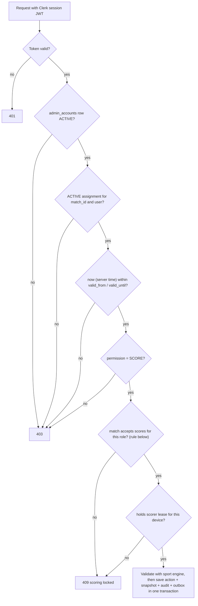
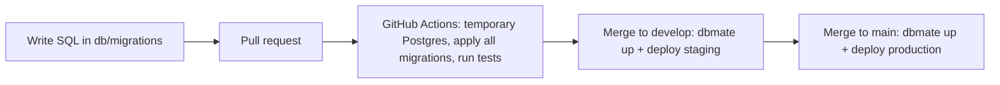

# Architecture

## Current implementation — 9 October 2026

The first application feature is a React + Vite JavaScript frontend in `frontend/`, managed through a root npm workspace and committed lockfile. React Router registers the homepage, six sport pages with display fixtures and reserved tournament destinations. The stack was confirmed on 11 October 2026; see [memory.md](memory.md#backend-and-hosting-decisions--11-october-2026).

Update, 20 October 2026: the `backend/` Worker (Hono API, `MatchRoom` live rooms, Clerk sign-in, assignments, leases, the scoring write path with the Test_Engine, outbox sweep), the `db/` migrations, the operator console and the sign-in and privacy pages are implemented and deployed to staging and production ([tasks.md](tasks.md#backend-live-platform--published-20-october-2026)). This integration adds real scoring with frozen presets/custom formats and operator final confirmation; see the current task in tasks.md for verification/publication. Not implemented: tournament, team, roster and match management; bracket advancement; standings. Manager result review is superseded. Sections below that describe these parts are the target design.

Current folders: `frontend/src/app/` (routes), `components/` (header/icons/native rail), `data/` (sport IDs), `features/home/` (hero/matrix/filter/composition), `features/matches/` and `features/tournaments/` (sections/cards/display fixtures), `features/sports/` (shared sport page, sections, cards, dialog, calendar, fixture registry and one fixture folder per sport), `styles/` (visual tokens), `frontend/public/` (local assets/favicon), and `frontend/tests/` (browser integration checks). Component styles sit alongside components. Setup is in `doc/local-development.md`. Current integration contracts are in `doc/handoff.md`.

The homepage owns its selected-sport state and passes filtered display data to presentational match cards. It has no persistence or network score feed. The shared native rail uses IntersectionObserver on stable card slots for partial-card emphasis; the canvas effect has lifecycle cleanup, a capped refresh rate, reduced-motion handling and offscreen/tab-hidden suspension. Build output is static files in `frontend/dist/`. Nested-route deployments require an index.html fallback.

GitHub Actions runs **frontend lint, build and browser tests** on Ubuntu, Windows and macOS: Chromium and an emulated Pixel on all three, plus Firefox, WebKit and emulated iPhone and iPad on Ubuntu and macOS. New frontend specs join the same suite. Extend test commands, jobs and path triggers when new application layers are implemented; follow the verification policy in `AGENTS.md`. Backend CI, deploy, backup and bootstrap workflows are described in [Database hosting and migrations](#database-hosting-and-migrations). Create future feature folders only when they contain actual implementation; do not add empty backend or database scaffolding for this milestone.

## Overview

Responsive website for tournaments and live sports scores. Tournament-specific public navigation is:

`Tournament list → Tournament → Enabled sport → Match → Scorecard`

The implemented homepage additionally has global sport links in its header and in-place sport filters for its live-match row. These are distinct controls; filters do not navigate.

Each tournament can enable any subset of football, volleyball, basketball, table tennis, lawn tennis, and badminton. Each sport has its own configurable match format and scoring rules.

Super Admins and Tournament Managers run tournaments across all enabled sports. Match Operators score only the specific matches they are assigned to. Spectators read public data without an account.

## Technology

- Frontend: React + Vite (JavaScript), served as Cloudflare Workers static assets with the SPA fallback
- API: one Cloudflare Worker with Hono (JavaScript); staff commands, including scoring, use HTTPS
- Live updates: SQLite-backed Durable Objects with the WebSocket Hibernation API; one room per match and one `home` room; viewer sockets are receive-only
- Database: Neon Postgres (separate staging and production projects); no Postgres runs on any team device
- Database connection: Cloudflare Hyperdrive with the `pg` driver; a cached configuration for public reads and an uncached one for everything else
- Sign-in: Clerk. Anyone can sign up with a verified email or Google; staff roles come only from invitations recorded in our database
- Schema changes: plain SQL migrations in `db/migrations/`, applied with `dbmate` by GitHub Actions only

PostgreSQL is the source of truth. Durable Object rooms send committed updates to connected viewers; they are not the score database.

## Repository structure

The following is the **target structure for the full application**, not a list of completed modules. The current frontend structure is recorded above and in the handoff.

Keep frontend and backend independent. Register frontend routes only in `frontend/src/app/App.jsx`. Put page UI in its feature folder and shared UI in `components/`. Put sport-specific UI and scoring behavior in that sport's module. Add folders only when they contain needed implementation. A future route extraction needs an agreed contract and a coordinated task first.

```text
frontend/
  src/
    app/                         # App.jsx: central route registration and app setup
    components/                  # reusable buttons, cards, tables, dialogs, status UI
    features/
      tournaments/               # tournament list, detail, and setup UI
      teams/                     # teams and roster management UI
      matches/                   # match list and detail UI
      access/                    # account invites, Assign Scorer, revoke/reassign
      operator/                  # My Matches and scoring entry for Match Operators
      sports/
        football/
          components/
          scoring/               # sport-specific score input and display
        volleyball/
          components/
          scoring/
        basketball/
          components/
          scoring/
        table-tennis/
          components/
          scoring/
        lawn-tennis/
          components/
          scoring/
        badminton/
          components/
          scoring/
    services/                    # HTTP API and live WebSocket clients
    state/                       # shared client state where needed

backend/
  wrangler.jsonc                 # Worker, Durable Object, Hyperdrive, cron and environment config
  src/
    index.js                     # Hono app, static assets, live-socket routing, scheduled handler
    http.js                      # request ID, error body, public field allow-lists
    auth.js                      # Clerk token check, account load, role checks
    scoring.js                   # scoring authorization chain and match-state rule
    rooms.js                     # MatchRoom Durable Object (match rooms and the home room)
    outbox.js                    # outbox sweep
    db.js                        # Hyperdrive pools and transactions
    routes/                      # public, me, invites, assignments, leases, actions
    engines/                     # legacy Test_Engine registry; real calculations in shared/scoring.mjs
  scripts/                       # Super Admin bootstrap, smoke check
  test/

db/
  migrations/                    # <timestamp>_name.sql, applied in order by dbmate in CI
  seed/fake.sql                  # fake data for CI and staging only

.github/
  workflows/                     # frontend and backend CI, deploy, backup and bootstrap workflows

doc/                             # project documentation
```

Keep each backend sport module responsible for validating that sport's score actions and calculating its score/result. Shared services can call a sport module through a small common interface; avoid putting sport rules in route handlers or UI components. Frontend sport folders contain sport-specific scoring controls and scorecards; reusable layout and form elements stay in `components/`.

## Roles and access

Core principle:

- **Authentication** answers "who is this person?" (Clerk).
- **Role** answers "what can this type of user do?" (`admin_accounts.role`).
- **Match assignment** answers "which specific match can this person operate?" (`match_operator_assignments`).

Roles are stored explicitly as `SUPER_ADMIN`, `TOURNAMENT_MANAGER`, or `MATCH_OPERATOR`. A Spectator needs no account. A signed-in account with no `admin_accounts` row is a Viewer: it has exactly the Spectator column's rights. Each account has exactly one role; Super Admin includes every Tournament Manager capability. Tournament Managers are global across all tournaments. There are no sport-scoped admin roles.

| Capability | Super Admin | Tournament Manager | Match Operator | Spectator |
| --- | --- | --- | --- | --- |
| View public tournaments, matches, scores | Yes | Yes | Yes | Yes |
| Create/edit tournaments, enable and configure sports | Yes | Yes | No | No |
| Create/edit teams and players | Yes | Yes | No | No |
| Create/edit matches and bracket assignments | Yes | Yes | No | No |
| Invite Match Operators | Yes | Yes | No | No |
| Invite/disable Tournament Managers and Super Admins | Yes | No | No | No |
| Assign, revoke, reassign scorers | Yes | Yes | No | No |
| View assigned match (private scoring view) | Yes, after self-assignment | Yes, after self-assignment | Assigned matches only | No |
| Start scoring, enter live scores, undo live actions, finish match, submit result | With active assignment | With active assignment | With active assignment | No |
| Confirm final score and permanently lock it | With active assignment | With active assignment | With active assignment | No |
| Record exceptional outcomes (tie, forfeit, abandonment) | Yes | Yes | No | No |
| Edit a finalized result | No | No | No | No |
| View audit history | Yes | Yes | No | No |

A manager or Super Admin who wants to score a match assigns themselves first; that assignment is audited like any other. Scoring always goes through the same assignment check.

### Scoring authorization chain

Every protected scoring HTTP command runs this chain server-side. Account and assignment state are read from the database on every request, not only at sign-in or from token claims, so a revocation takes effect on the next command. Hidden UI buttons are never the control.



An assignment is valid when its status is `ACTIVE`, its permission is `SCORE`, and server time is within its window. A null bound is open. The lower bound is inclusive; the upper bound is exclusive. With no `valid_until`, the assignment still cannot bypass a locked match or revocation.

Apply this match-state rule after the account, assignment, time-window and permission checks:

```js
const acceptsScores = match.status === 'LIVE' ||
  (match.status === 'REJECTED' &&
    (match.correction_route === 'OPERATOR' ||
      (match.correction_route === 'MANAGER' &&
        ['TOURNAMENT_MANAGER', 'SUPER_ADMIN'].includes(account.role))))
```

The existing backend gate retains legacy `REJECTED` row compatibility. New scoring starts eligible `SCHEDULED` matches with `START`, requires the scheduled date to be today in Asia/Kolkata, and accepts later commands while `LIVE`. An exact accepted `FINALIZE` retry may replay a locked result after current authorization checks. New writes to final matches are refused. The new workflow never creates rejected or pending-review states and has no reopening endpoint.

Non-scoring privileged requests (tournament, team, match, assignment and account management) check token → active account → required role.

### Staff invitation

1. A Tournament Manager selects a match and chooses **Assign Scorer**, or a Super Admin invites a manager or Super Admin.
2. The backend checks the inviter's role: managers can invite `MATCH_OPERATOR` only.
3. The backend calls the Clerk Invitations API with the secret key (server-side only), then stores a pending invitation row and an audit row in one transaction. Clerk sends the email.
4. The invited person signs up or signs in through Clerk with the same verified email, by email or Google.
5. The backend matches the verified email to the pending invitation and creates the `admin_accounts` row with the invited role, with an audit row.
6. For an operator, the manager creates the assignment row (audited). The backend verifies the active assignment on each request, and the operator sees only assigned matches.

Example: Football SF1 → Rahul → `SCORE` → 09:30–12:30.

Only a Super Admin creates Tournament Managers and Super Admins. Sign-up without an invitation gives only the Viewer role. Ending a match never deletes the user account; only the assignment expires or is revoked.

## Main backend request flow

1. A Hono route receives the request.
2. Middleware verifies the Clerk session JWT, loads the `admin_accounts` row, and checks the required role. Scoring commands also run the full assignment chain above. Request data is validated.
3. The service applies tournament/match workflow and calls the appropriate sport module for scoring rules.
4. The database transaction saves the score action, updated match state, audit entry, and live-update outbox record.
5. After commit, the Worker publishes the public snapshot to the match room and the `home` room. A cron sweep resends any undelivered outbox event.

Public routes are read-only and need no account.

## Tournament, bracket, and result rules

- A tournament stores its enabled sports and each sport's validated format/scoring configuration.
- Each tournament sport has exactly two semifinal matches and one final. A Tournament Manager or Super Admin assigns teams to the semifinal sides.
- A semifinal winner advances to the final only after that semifinal result is approved.
- Custom matches are separate from the bracket and never advance bracket slots.
- Current result flow: eligible `SCHEDULED → LIVE → APPROVED`. The assigned operator chooses and freezes the format at start, enters scores, corrects live mistakes, then confirms the computed final result. Confirmation immediately publishes and locks it. There is no separate review or post-final edit endpoint. See [rules.md](rules.md#6-score-corrections-and-final-results).
- Legacy `PENDING_APPROVAL` and `REJECTED` rows remain readable. They are not targets of this new workflow.

## Main data records

- `tournaments`: name, dates, status, and event details.
- `tournament_sports`: enabled sport, format/rules configuration, configuration version, and standings options.
- `teams`: teams scoped to a tournament sport.
- `roster_players`: player entries scoped to a sport team; display name, branch/year, captain marker, optional jersey number and active state.
- `match_roster`: selected `roster_players` for a match, with active/substitute state.
- `matches`: participants, schedule, sport configuration snapshot, status, result, and bracket/custom type.
- `bracket_slots`: the two semifinal assignments and final slots linked to approved semifinal winners.
- `score_actions`: ordered, auditable sport-specific scoring events, including linked reversal actions for undo/correction.
- `match_snapshots` and `sport_standings`: derived current match and standings views.
- `admin_accounts`: Clerk user ID, `role` (`SUPER_ADMIN` | `TOURNAMENT_MANAGER` | `MATCH_OPERATOR`), `status` (`ACTIVE` | `DISABLED`), `invited_by`, timestamps. No `is_admin` flag.
- `match_operator_assignments`:
  - `id`, `match_id`, `user_id`, `assigned_by`
  - `permission`: `'SCORE'` only (default)
  - `valid_from`, `valid_until`: both nullable; check `valid_until > valid_from` when both are set
  - `status`: `ACTIVE` | `REVOKED` only; "expired" is derived from time and never stored
  - `created_at`, `revoked_at`, `revoked_by`, `revoke_reason`
  - partial unique index on `match_id` where `status = 'ACTIVE'` (one active operator per match)
  - reassignment revokes the old row and inserts a new one in one audited transaction
- `scorer_leases`: the one active scoring device/session for a match. The assignment says **who** may score; the lease says **which device** is scoring now, preventing the same operator scoring from two tabs.
- `match_result_reviews`: existing legacy review schema, unused by the current operator-finalization workflow. Preserve its constraints for compatibility; do not build review endpoints from this obsolete proposal.
- `admin_audit_log`: actor, action, entity, time, request ID, before/after summary, and reason. Covers account changes, assignments, revocations, reassignments, self-assignments, score reversals, match start and final confirmation.
- `outbox_events`: committed changes waiting to be broadcast.

These are planned record names, not existing database tables. Use `roster_players` as the canonical player table name; do not create a second `players` table for the same records. Use database constraints for relationships and uniqueness. Save the sport configuration version with each match so later settings do not alter a live match.

Before backend work, agree the task's routes, payloads, statuses, authorization and error cases in these shared docs. Record unresolved decisions in `memory.md` and block the dependent task in `tasks.md`. The selected stack is a plan; it does not prove that the service, schema or capacity exists.

## Database hosting and migrations

No Postgres runs on any team device, including when the schema changes. All environments are hosted Neon projects.

- **Environments:** one Neon project for staging (`Campuscores-staging`) and one for production (`Campuscores-production`), region `aws-ap-southeast-1`, Postgres 18. The plan caps autoscaling at 0.5 CU; both projects are now set to a maximum of 2 CU (lower it in the Neon console). CI service containers and the backup client use the same major (18).
- **Migrations:** plain SQL files in `db/migrations/<timestamp>_name.sql`, applied in order with a pinned `dbmate`. `dbmate` records applied migrations in the database and applies only pending files.
- **Golden rule:** change a hosted schema only through a CI migration. Never edit it through the Neon console SQL editor.
- **Testing without a local database:** CI applies every migration to a throwaway Postgres service container on the GitHub Actions runner, runs integration tests, and discards it.
- **Deploying:** only GitHub Actions applies migrations and deploys the Worker: a push to `develop` deploys staging, a merged release pull request to `main` deploys production. Secrets live in GitHub Environments (`staging`, `production`).
- **Deploy workflow:** [`.github/workflows/deploy.yml`](../.github/workflows/deploy.yml) runs on push to `develop` (Environment `staging`) or `main` (Environment `production`). One run at a time per environment; a newer push waits and never cancels a running deploy. Order: `npm ci`; frontend lint; backend lint; backend tests against a throwaway Postgres with `REQUIRE_DB=1`; frontend Chromium and Pixel tests; `dbmate up` on the environment database; fake seed (staging only); `npm run build` with the environment `VITE_*` values; `wrangler deploy --env <env>` from `backend/`; the Smoke_Script [`backend/scripts/smoke.js`](../backend/scripts/smoke.js) against `VITE_API_BASE` (`GET /health` 200, `GET /api/tournaments` 200, first `/live/home` message within 10 s, `GET /api/me` 401 without a token; it exits 1 and names the failed check). Known limit: the smoke step runs seconds after `wrangler deploy`, before the custom-domain route can serve the new Worker. On production it can fail with `GET /health` 522 while the deploy is good; re-run the job or run `node backend/scripts/smoke.js <url>` after a minute. Any failed step stops the run, so a failed migration never deploys the Worker. Migrations must stay compatible with the running Worker (expand, deploy, then contract).
- **Per-environment settings** (set the same names in both GitHub Environments, with that environment's values):

  | Name | Kind | Value |
  | --- | --- | --- |
  | `DATABASE_URL` | Secret | Neon **direct** (unpooled) connection string with `sslmode=require` |
  | `CLOUDFLARE_API_TOKEN` | Secret | Cloudflare API token with Workers deploy rights for the account |
  | `CLOUDFLARE_ACCOUNT_ID` | Secret | Cloudflare account ID |
  | `VITE_API_BASE` | Variable | Public API base URL of that environment (public; sent to the browser) |
  | `VITE_CLERK_PUBLISHABLE_KEY` | Variable | Clerk publishable key of that environment's instance (public) |

  `CLERK_SECRET_KEY` and `CLERK_JWT_KEY` are Worker secrets; `CLERK_PUBLISHABLE_KEY`, `AUTHORIZED_PARTIES` and `INVITE_REDIRECT_URL` (the sign-up page URL in invitation emails) are Worker vars. The Worker reads them for staff routes ([Sign-in setup](#sign-in-setup)). The vars are set per environment in `backend/wrangler.jsonc`; set the secrets once per environment with `npx wrangler secret put <NAME> --env <env>`. They are never in the config or the deploy workflow.
- **Wrangler environments:** `env.staging` uses `workers_dev` and the Clerk development instance, and sets `ENABLE_TEST_ENGINE`. `env.production` sets `workers_dev: false`, one zone route on the custom domain, the Clerk production instance vars and no `ENABLE_TEST_ENGINE`. Each environment repeats its DO, Hyperdrive and cron bindings. `backend/test/node/wrangler-config.spec.js` checks this. Set the route's fail-closed request-limit mode in the Cloudflare dashboard ([Rate limiting](#rate-limiting-and-quota-failure)).
- **Environment addresses:** staging serves `https://thaparlympics-staging.bhatiaarnav05.workers.dev` (Clerk development instance); production serves `https://campuscores.live` through the zone route `campuscores.live/*` and a proxied `AAAA 100::` apex record (Clerk production instance; its DNS records stay DNS only). `www.campuscores.live` is not configured. Both environments are deployed from commit `4405c8b` (20 October 2026); the smoke checks pass on both. Known limit: the Clerk Worker secrets on production, the route fail-closed mode and the rate-limit rule are set outside source and are not confirmed.
- **Seed data:** `db/seed/fake.sql` holds clearly fake data for CI and staging only; never seed production.
- **Backups:** [`.github/workflows/backup.yml`](../.github/workflows/backup.yml) runs nightly at 21:30 UTC (03:00 IST) and on manual dispatch, in GitHub Environment `production`. Neon Free keeps only 6 hours of restore history. Order: install `postgresql-client-18` from PGDG; fail unless the `pg_dump` and Neon server majors both equal `PG_MAJOR` (18, the Neon staging and production major; change it, and the `postgres:18` images, if Neon's major changes); `pg_dump --format=custom`; `gpg --symmetric --cipher-algo AES256` with the passphrase from a private file; delete the plaintext dump; upload only the `.gpg` file as artifact `production-backup-<run id>` (14-day retention); decrypt, `pg_restore --exit-on-error --no-owner --no-acl` into a throwaway `postgres:18` service; fail if any table created in `db/migrations` or `schema_migrations` is missing. Any failed step fails the run. Secrets in Environment `production`: `DATABASE_URL` (above) and `BACKUP_PASSPHRASE` (long random passphrase; store a copy outside GitHub, because GitHub cannot show it again and without it no backup can be decrypted). To restore: download the artifact, run `gpg --decrypt` with the passphrase, then `pg_restore` into a new Neon branch or project. The workflow is disabled in GitHub since 20 October 2026. It returns before launch with private R2 storage and its own environment ([memory.md](memory.md#public-repository-and-ci--20-october-2026)).



### Backend connection

- The Worker connects to Neon through Cloudflare Hyperdrive with the `pg` driver and SSL.
- **Cached configuration:** public read routes only.
- **Uncached configuration:** sign-in, roles, assignments, leases and every write. A cached read would delay a revocation.
- Browsers never connect to the database. All data access goes through the Worker.

### Public read API

Source: [`backend/src/routes/public.js`](../backend/src/routes/public.js). No authentication; every caller gets the same body through the cached configuration.

- `GET /api/tournaments` → `{ tournaments: [tournament] }`
- `GET /api/tournaments/:id` → `{ tournament }` with `sports` (sport keys) and `matches`
- `GET /api/matches/:id` → `{ match }` with `snapshot` (the latest Match_Room snapshot data, or `null`)
- An ID is a positive integer without a leading zero, up to 18 digits. Otherwise 400 `BAD_REQUEST`. An unknown or non-public ID returns 404 `NOT_FOUND`.
- Every body and Room_Message goes through `toPublic(kind, obj)` in [`backend/src/http.js`](../backend/src/http.js). It copies only the allow-listed fields for `tournament`, `match`, `snapshot` and `card`. Database IDs are strings; dates are ISO text.
- Current limits: `DRAFT` tournaments and `CUSTOM` matches are not public while the lifecycle and custom-match visibility questions in [memory.md](memory.md) are open. `snapshot` is `null` until the match has a `match_snapshots` row (its first accepted score action).

### Sign-in setup

- Clerk Free: open sign-up, required email verification, the suspicious-sign-up challenge on, and Google as the only social provider.
- The Worker verifies session tokens with `@clerk/backend` and an `authorizedParties` allow-list. Roles never come from token claims.
- Source: [`backend/src/auth.js`](../backend/src/auth.js). `clerkAuth` verifies the token locally with `CLERK_JWT_KEY` and checks `azp` against `AUTHORIZED_PARTIES` (comma-separated origins); no token or a bad token returns 401 `UNAUTHENTICATED`. `loadAccount` reads `admin_accounts` by Clerk user ID through the uncached configuration on every request. `requireRole('staff' | 'manager' | 'superAdmin')` returns 403 `NOT_STAFF`, `ACCOUNT_DISABLED` or `ROLE_FORBIDDEN`. A missing Clerk setting returns 500, so a misconfigured Worker never grants access.
- `GET /api/me` (signed in) → `{ role, status }` for an `ACTIVE` staff account, else `{ role: 'VIEWER' }` (no row or `DISABLED`).
- `POST /api/invites { email, role }` (manager or above; [`routes/invites.js`](../backend/src/routes/invites.js)) → 201 `{ invitation: { id, email, role, status, expiresAt } }`. The email is stored in lower case and expires after 7 days. A role the caller cannot invite returns 403 `ROLE_FORBIDDEN`; a bad email 400; an unexpired pending invitation for that email 409 `INVITE_PENDING`. The Clerk invitation (redirect `INVITE_REDIRECT_URL`) is created first; a Clerk failure returns 502 `CLERK_UNAVAILABLE` and stores no row. If the database step then fails, the Clerk invitation is revoked (best effort) and the call returns 500.
- `POST /api/invites/accept` (signed in, no staff role needed) → `{ role, status }`. It matches the caller's verified Clerk emails to the oldest pending, unexpired invitation and creates the account with the invited role and `invited_by` in one transaction. No match returns 404 `INVITE_NOT_FOUND`; a caller who already has an account (also a disabled one) gets 409 `ACCOUNT_EXISTS` and nothing changes.
- `POST /api/accounts/:id/disable { reason }` (Super Admin; [`routes/accounts.js`](../backend/src/routes/accounts.js)) → `{ account: { id, status, revokedAssignmentIds } }`. One transaction sets `DISABLED`, revokes the account's `ACTIVE` assignments with the reason, deletes its scorer leases and writes an `ACCOUNT_DISABLED` audit row. An empty reason returns 409 `REASON_REQUIRED`; the last active Super Admin 409 `LAST_SUPER_ADMIN`; an unknown ID 404.
- The Clerk secret key stays on the Worker as a secret. Only the publishable key reaches the browser.
- Staging uses a Clerk development instance on `workers.dev`. Clerk's shared Google credentials are acceptable there.
- **Production identity setup** (manual, outside source; do it before the first production deploy):
  - The Clerk production instance serves `campuscores.live`. Its publishable key (`pk_live_…`) is `CLERK_PUBLISHABLE_KEY` and `AUTHORIZED_PARTIES` is `https://campuscores.live` in `env.production.vars` of `backend/wrangler.jsonc`. Set the same publishable key as `VITE_CLERK_PUBLISHABLE_KEY` in GitHub Environment `production`. These values are public.
  - From `backend/`, set the two Worker secrets: `npx wrangler secret put CLERK_SECRET_KEY --env production` and `npx wrangler secret put CLERK_JWT_KEY --env production` (the instance's JWKS public key in PEM form). Never put them in config, the workflow or a GitHub secret.
  - Google sign-in: create our own OAuth client in Google Cloud and enter its client ID and secret in the Clerk production instance. Clerk does not supply shared Google credentials for a production instance. Use the redirect URI that Clerk shows.
  - Google consent screen: set the privacy policy URL to `https://campuscores.live/privacy` (the [`PrivacyPage`](../frontend/src/features/legal/PrivacyPage.jsx) route) and the home page to `https://campuscores.live`. Add `campuscores.live` as an authorized domain.
  - DNS: add the CNAME records that the Clerk production instance lists to the `campuscores.live` zone in Cloudflare. Set each one to **DNS only** (grey cloud), not proxied. A proxied Clerk record breaks Clerk's domain and certificate checks.
  - Current state (21 October 2026, confirmed by Arnav): the Google app is published (In production). The OAuth client "campuscores Production Login" has the Clerk production callback as its redirect URI, and Clerk Production uses these custom credentials. The 5 Clerk CNAME records are DNS only. The consent screen branding is set: home page, privacy URL, authorized domain and support email `bhatiaarnav05@gmail.com`. On campus Wi-Fi, Google sign-in and email sign-up with a code work on `https://campuscores.live/sign-in`, and `https://accounts.campuscores.live` loads (Cloudflare check, no block page). Not confirmed: the Worker secrets ([tasks.md](tasks.md#follow-up-tasks) F7). The privacy owner and contact are recorded ([memory.md](memory.md#backend-open-items) item 4).
  - Campus DNS filter: the campus network uses a Fortinet DNS filter (block address `208.91.112.55`). On 21 October 2026 it returned the block address for some lookups of Clerk hostnames (`accounts.campuscores.live`; earlier, all Clerk names through `1.1.1.1`). Sign-in works now. Mitigation: ask campus IT to allow `campuscores.live` and `*.campuscores.live`, and recheck sign-in on campus Wi-Fi before the event ([memory.md](memory.md#backend-open-items) item 9).

### Plan and limits

Free-tier limits and the paid gate are recorded in [memory.md](memory.md#backend-and-hosting-decisions--11-october-2026). Design for daily request counts, not CPU:

- Viewers get the stored snapshot from the room on connect, so viewing never queries Neon.
- The outbox sweep skips Neon when no score was written in the last 15 minutes, so Neon can sleep.
- Public routes fail closed at the daily request cap. One rate-limit rule, counted per IP, covers API and sign-up paths, not live sockets. See [Rate limiting and quota failure](#rate-limiting-and-quota-failure).

### Rate limiting and quota failure

These are Cloudflare and Clerk dashboard settings for the production zone. They are not in source. The Cloudflare account and the `campuscores.live` zone exist, but the fail-closed mode and the rate-limit rule are not confirmed as set ([tasks.md](tasks.md#backend-manual-prerequisites-user)).

- **One WAF rate-limit rule.** Cloudflare Free allows one rule on our own zone. Settings:
  - Expression: `starts_with(http.request.uri.path, "/api/") or starts_with(http.request.uri.path, "/sign-up")`.
  - Counting characteristic: IP address.
  - Period: 10 seconds. Block (mitigation timeout): 10 seconds.
  - Name: `api-flood-guard`. Threshold: 300 requests per 10 seconds. Action: Block. Decided 21 October 2026 ([memory.md](memory.md#backend-open-items) item 3).
  - Free plan limits: one rule, IP-only counting, the URI Path field only, 10-second period and mitigation timeout, no Log action.
  - Rationale: campus Wi-Fi and Indian mobile carrier-grade NAT (CGNAT) put many viewers and operators behind one IP address. A low threshold would block legitimate users and operators during a match. With IP-only counting, no single threshold can protect the 100,000/day Worker quota. Quota protection relies on the fail-closed route, cached public reads and manual usage checks on event days. This rule is a flood guard only.
  - Campus observation (21 October 2026, one laptop): campus traffic leaves through at least three public IPv4 addresses on different providers (`112.196.126.3`, `117.203.246.44`, `14.139.242.98`), spread per connection. There is no IPv6. Requests reached the Cloudflare data centers BOM and MRS. Cloudflare counts the limit per IP and per data center, so the campus load is split across several counters. This supports the threshold of 300 per 10 seconds.
  - Review Security analytics after the first event day. Lower the threshold if abuse appears.
  - The user applies the rule in the Cloudflare dashboard. It is not yet confirmed as applied.
  - The score console retries an HTTP 429 with backoff, like a 5xx, so a blocked operator does not need to resume sync by hand.
- **Not on `/live/`.** Campus Wi-Fi puts many viewers behind one IP address. A per-IP limit on live sockets would block them together. The expression above does not match `/live/`. Keep it that way.
- **Clerk Frontend API.** Clerk serves it on its own DNS-only subdomain `clerk.campuscores.live`, so our zone rule cannot reach it. Clerk Bot protection (the suspicious-sign-up challenge, [Sign-in setup](#sign-in-setup)) covers it.
- **Fail-closed route mode.** Only the production Worker route `campuscores.live/*` has this mode; staging uses `workers.dev` and has no route. The production route uses the request-limit failure mode **fail closed**. At the daily Worker request cap, requests get error 1027. They never bypass the Worker. API and live calls then fail, and the frontend shows that live scores are unavailable. Cloudflare documents that static assets keep loading at the cap; this is untested ([memory.md](memory.md#backend-open-items) item 7).
- **Notifications and usage checks.** The Cloudflare Platform Notifications list has no Workers or Durable Objects usage alert for the Free plan. "Usage Based Billing" needs a Professional plan or higher with pay-as-you-go ([Cloudflare docs](https://developers.cloudflare.com/notifications/notification-available/)). Do not expect an automatic email before a Free plan cap.
  - Turn on "HTTP DDoS Attack Alert" (all plans) for the account.
  - On event days, check the Workers & Pages usage metrics by hand against the daily caps in [memory.md](memory.md#research-notes).
  - Workers Paid (the paid gate) adds usage-based alerts, if it is adopted.

## Live updates and offline scoring

- Viewers open a receive-only WebSocket to the relevant match room or the `home` room. The room sends its stored snapshot first, then each newer snapshot. An empty `home` room sends an empty list (`seq` 0) first; an empty match room sends nothing until its first publish ([handoff.md](handoff.md#room_message)).
- Broadcast only public fields. Account identities, assignments, audit details, and private roster data are not sent to public rooms.
- Publish from the database outbox after transaction commit. Each snapshot carries the match sequence; a room ignores an older sequence. On reconnect, the client replaces its state with the room's first message.
- While a match is `LIVE`, the assigned operator can undo or correct as many times as needed, with no extra permission and no reason prompt. Each undo is stored as a linked reversal action with actor and server time; accepted actions are never erased. Live undos show no public correction marker. After operator final confirmation, no edits or reopening are allowed.
- The operator downloads the current match snapshot, stores actions locally when offline, sends them in order after reconnect, and retries with the same action ID to prevent duplicate scoring.
- The server validates each synced action against the operator's assignment and the score sequence, using **server receipt time** (the device clock is untrusted). If actions arrive after `valid_until` or after the assignment was revoked, sync pauses and a manager either extends the window or resolves the conflict.
- Mark offline actions as pending until the server confirms them. Pause sync and request manager resolution if match state or score sequence conflicts.
- One primary scoring device per match, enforced by `scorer_leases`.
- Split a room across several Durable Objects only if a measurement shows one room is not enough.

## Security basics

- Spectators view public tournament and match data without signing in; they cannot change data.
- Anyone can sign in through Clerk, but only an invitation recorded in our database grants a staff role. Every protected request checks the token, loads the account from the database, and checks its role; scoring commands also run the full assignment chain.
- An operator attempting to score or open the private view of an unassigned match receives 403 Forbidden. A locked match returns 409.
- Managers can invite Match Operators only; only Super Admins create managers and Super Admins.
- Viewer sockets are receive-only and ignore incoming messages. Scoring commands use HTTPS and run the authorization chain per command; room membership grants nothing.
- Keep database credentials and the Clerk secret key on the Worker as secrets.
- Validate input on the backend, use HTTPS/WSS in deployed environments, and audit account changes, assignments, revocations, reassignments, score reversals, match start and final confirmation.

## Operator scoring integration contract — 20 October 2026

All commands keep the existing action ID, client sequence, assignment and lease contract. Start stores a validated format and source/version with the match. Scoring and manual early set endings derive a new snapshot. Final confirmation writes the final status and snapshot in the same transaction as the action, audit and outbox. Replaying a lost final response is idempotent; new writes to a final match are refused. The backend and frontend use the same pure scoring calculations, but the backend validates and decides acceptance. Pending offline projections are never presented as server-accepted results.

Private scoring reads return only the assigned match and its accepted scoring actions through the uncached connection. Public snapshots/cards allow-list set/period points, winners, current state and display events; they exclude staff IDs, device IDs, tokens and raw command history. The home feed separates live matches from completed results. Public visibility still follows the published tournament/non-custom match boundary.
