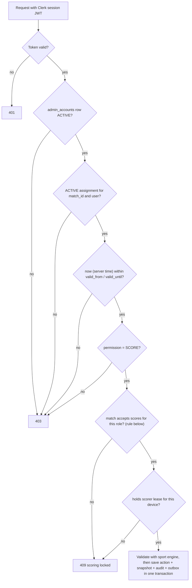
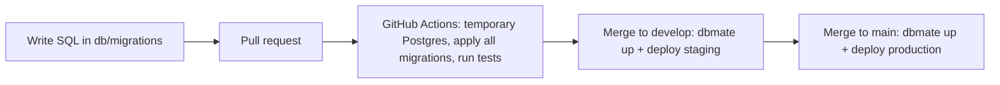

# Architecture

## Current implementation — 9 October 2026

The first application feature is a React + Vite JavaScript frontend in `frontend/`, managed through a root npm workspace and committed lockfile. React Router registers the homepage, six sport pages with display fixtures and reserved tournament destinations. No backend Worker, database, authentication, scoring engine or live delivery has been added. Those parts below describe the target application. The stack was confirmed on 11 October 2026; see [memory.md](memory.md#backend-and-hosting-decisions--11-october-2026).

Current folders: `frontend/src/app/` (routes), `components/` (header/icons/native rail), `data/` (sport IDs), `features/home/` (hero/matrix/filter/composition), `features/matches/` and `features/tournaments/` (sections/cards/display fixtures), `features/sports/` (shared sport page, sections, cards, dialog, calendar, fixture registry and one fixture folder per sport), `styles/` (visual tokens), `frontend/public/` (local assets/favicon), and `frontend/tests/` (browser integration checks). Component styles sit alongside components. Setup is in `doc/local-development.md`. Current integration contracts are in `doc/handoff.md`.

The homepage owns its selected-sport state and passes filtered display data to presentational match cards. It has no persistence or network score feed. The shared native rail uses IntersectionObserver on stable card slots for partial-card emphasis; the canvas effect has lifecycle cleanup, a capped refresh rate, reduced-motion handling and offscreen/tab-hidden suspension. Build output is static files in `frontend/dist/`. Nested-route deployments require an index.html fallback.

GitHub Actions runs **frontend lint, build and browser tests** on Ubuntu, Windows and macOS: Chromium, Firefox and an emulated Pixel on all three, plus WebKit and emulated iPhone and iPad on Ubuntu and macOS. New frontend specs join the same suite. Extend test commands, jobs and path triggers when new application layers are implemented; follow the verification policy in `AGENTS.md`. Database/migration/deployment workflows below remain future work. Create future feature folders only when they contain actual implementation; do not add empty backend or database scaffolding for this milestone.

## Overview

Responsive website for tournaments and live sports scores. Tournament-specific public navigation is:

`Tournament list → Tournament → Enabled sport → Match → Scorecard`

The implemented homepage additionally has global sport links in its header and in-place sport filters for its live-match row. These are distinct controls; filters do not navigate.

Each tournament can enable any subset of football, volleyball, basketball, table tennis, lawn tennis, and badminton. Each sport has its own configurable match format and scoring rules.

Super Admins and Tournament Managers run tournaments across all enabled sports. Match Operators score only the specific matches they are assigned to. Spectators read public data without an account.

## Technology

- Frontend: React + Vite (JavaScript), served as Cloudflare Workers static assets with the SPA fallback
- API: one Cloudflare Worker with Hono (JavaScript); staff commands, including scoring, use HTTPS
- Live updates: SQLite-backed Durable Objects with the WebSocket Hibernation API; one room per match and one `home` room; viewer sockets are receive-only
- Database: Neon Postgres (separate staging and production projects); no Postgres runs on any team device
- Database connection: Cloudflare Hyperdrive with the `pg` driver; a cached configuration for public reads and an uncached one for everything else
- Sign-in: Clerk. Anyone can sign up with a verified email or Google; staff roles come only from invitations recorded in our database
- Schema changes: plain SQL migrations in `db/migrations/`, applied with `dbmate` by GitHub Actions only

PostgreSQL is the source of truth. Durable Object rooms send committed updates to connected viewers; they are not the score database.

## Repository structure

The following is the **target structure for the full application**, not a list of completed modules. The current frontend structure is recorded above and in the handoff.

Keep frontend and backend independent. Register frontend routes only in `frontend/src/app/App.jsx`. Put page UI in its feature folder and shared UI in `components/`. Put sport-specific UI and scoring behavior in that sport's module. Add folders only when they contain needed implementation. A future route extraction needs an agreed contract and a coordinated task first.

```text
frontend/
  src/
    app/                         # App.jsx: central route registration and app setup
    components/                  # reusable buttons, cards, tables, dialogs, status UI
    features/
      tournaments/               # tournament list, detail, and setup UI
      teams/                     # teams and roster management UI
      matches/                   # match list, detail, and result review UI
      access/                    # account invites, Assign Scorer, revoke/reassign
      operator/                  # My Matches and scoring entry for Match Operators
      sports/
        football/
          components/
          scoring/               # sport-specific score input and display
        volleyball/
          components/
          scoring/
        basketball/
          components/
          scoring/
        table-tennis/
          components/
          scoring/
        lawn-tennis/
          components/
          scoring/
        badminton/
          components/
          scoring/
    services/                    # HTTP API and live WebSocket clients
    state/                       # shared client state where needed

backend/
  wrangler.jsonc                 # Worker, Durable Object, Hyperdrive, cron and environment config
  src/
    index.js                     # Hono app, static assets, live-socket routing, scheduled handler
    http.js                      # request ID, error body, public field allow-lists
    auth.js                      # Clerk token check, account load, role checks
    scoring.js                   # scoring authorization chain and match-state rule
    rooms.js                     # MatchRoom Durable Object (match rooms and the home room)
    outbox.js                    # outbox sweep
    db.js                        # Hyperdrive pools and transactions
    routes/                      # public, me, invites, assignments, leases, actions
    engines/                     # sport engine registry; production engines wait for rules.md
  scripts/                       # Super Admin bootstrap, smoke check
  test/

db/
  migrations/                    # <timestamp>_name.sql, applied in order by dbmate in CI
  seed/fake.sql                  # fake data for CI and staging only

.github/
  workflows/                     # frontend and backend CI, deploy, backup and bootstrap workflows

doc/                             # project documentation
```

Keep each backend sport module responsible for validating that sport's score actions and calculating its score/result. Shared services can call a sport module through a small common interface; avoid putting sport rules in route handlers or UI components. Frontend sport folders contain sport-specific scoring controls and scorecards; reusable layout and form elements stay in `components/`.

## Roles and access

Core principle:

- **Authentication** answers "who is this person?" (Clerk).
- **Role** answers "what can this type of user do?" (`admin_accounts.role`).
- **Match assignment** answers "which specific match can this person operate?" (`match_operator_assignments`).

Roles are stored explicitly as `SUPER_ADMIN`, `TOURNAMENT_MANAGER`, or `MATCH_OPERATOR`. A Spectator needs no account. A signed-in account with no `admin_accounts` row is a Viewer: it has exactly the Spectator column's rights. Each account has exactly one role; Super Admin includes every Tournament Manager capability. Tournament Managers are global across all tournaments. There are no sport-scoped admin roles.

| Capability | Super Admin | Tournament Manager | Match Operator | Spectator |
| --- | --- | --- | --- | --- |
| View public tournaments, matches, scores | Yes | Yes | Yes | Yes |
| Create/edit tournaments, enable and configure sports | Yes | Yes | No | No |
| Create/edit teams and players | Yes | Yes | No | No |
| Create/edit matches and bracket assignments | Yes | Yes | No | No |
| Invite Match Operators | Yes | Yes | No | No |
| Invite/disable Tournament Managers and Super Admins | Yes | No | No | No |
| Assign, revoke, reassign scorers | Yes | Yes | No | No |
| View assigned match (private scoring view) | Yes, after self-assignment | Yes, after self-assignment | Assigned matches only | No |
| Start scoring, enter live scores, undo live actions, finish match, submit result | With active assignment | With active assignment | With active assignment | No |
| Approve/reject results | Yes, not own submission | Yes, not own submission | No | No |
| Override the no-self-approval rule (reason required) | Yes | No | No | No |
| Record exceptional outcomes (tie, forfeit, abandonment) | Yes | Yes | No | No |
| Correct an approved result (new version + new approval) | Yes | Yes | No | No |
| View audit history | Yes | Yes | No | No |

A manager or Super Admin who wants to score a match assigns themselves first; that assignment is audited like any other. Scoring always goes through the same assignment check.

### Scoring authorization chain

Every protected scoring HTTP command runs this chain server-side. Account and assignment state are read from the database on every request, not only at sign-in or from token claims, so a revocation takes effect on the next command. Hidden UI buttons are never the control.



An assignment is valid when its status is `ACTIVE`, its permission is `SCORE`, and server time is within its window. A null bound is open. The lower bound is inclusive; the upper bound is exclusive. With no `valid_until`, the assignment still cannot bypass a locked match or revocation.

Apply this match-state rule after the account, assignment, time-window and permission checks:

```js
const acceptsScores = match.status === 'LIVE' ||
  (match.status === 'REJECTED' &&
    (match.correction_route === 'OPERATOR' ||
      (match.correction_route === 'MANAGER' &&
        ['TOURNAMENT_MANAGER', 'SUPER_ADMIN'].includes(account.role))))
```

This is a planned backend contract, not implemented frontend code. `OPERATOR` correction uses the valid current assignment. `MANAGER` correction accepts only a Tournament Manager or Super Admin who assigned themselves. Match Operators remain locked out, even if an old assignment is still active. The device lease and sport validation remain required in both routes. All other match states reject score commands with 409.

For a manager correction, revoke the previous assignment and create the manager's self-assignment in one audited transaction. Keep one active assignment per match. Record the correction reason and actions, then require resubmission and a new review. Do not let a manager bypass the common scoring authorization chain.

Non-scoring privileged requests (tournament, team, match, assignment, review, account management) check token → active account → required role.

### Staff invitation

1. A Tournament Manager selects a match and chooses **Assign Scorer**, or a Super Admin invites a manager or Super Admin.
2. The backend checks the inviter's role: managers can invite `MATCH_OPERATOR` only.
3. The backend calls the Clerk Invitations API with the secret key (server-side only), then stores a pending invitation row and an audit row in one transaction. Clerk sends the email.
4. The invited person signs up or signs in through Clerk with the same verified email, by email or Google.
5. The backend matches the verified email to the pending invitation and creates the `admin_accounts` row with the invited role, with an audit row.
6. For an operator, the manager creates the assignment row (audited). The backend verifies the active assignment on each request, and the operator sees only assigned matches.

Example: Football SF1 → Rahul → `SCORE` → 09:30–12:30.

Only a Super Admin creates Tournament Managers and Super Admins. Sign-up without an invitation gives only the Viewer role. Ending a match never deletes the user account; only the assignment expires or is revoked.

## Main backend request flow

1. A Hono route receives the request.
2. Middleware verifies the Clerk session JWT, loads the `admin_accounts` row, and checks the required role. Scoring commands also run the full assignment chain above. Request data is validated.
3. The service applies tournament/match workflow and calls the appropriate sport module for scoring rules.
4. The database transaction saves the score action, updated match state, audit entry, and live-update outbox record.
5. After commit, the Worker publishes the public snapshot to the match room and the `home` room. A cron sweep resends any undelivered outbox event.

Public routes are read-only and need no account.

## Tournament, bracket, and result rules

- A tournament stores its enabled sports and each sport's validated format/scoring configuration.
- Each tournament sport has exactly two semifinal matches and one final. A Tournament Manager or Super Admin assigns teams to the semifinal sides.
- A semifinal winner advances to the final only after that semifinal result is approved.
- Custom matches are separate from the bracket and never advance bracket slots.
- Result states: `LIVE → PENDING_APPROVAL → APPROVED/FINAL`, or `PENDING_APPROVAL → REJECTED/CORRECTION`. Live score updates can be visible before approval, but only approved results are final.
- The assigned operator submits the result. A Tournament Manager or Super Admin reviews it. The reviewer must differ from the submitter, whatever their role. A Super Admin can override this only with a recorded reason; the override is audited.
- On rejection, the reviewer records a reason and chooses `OPERATOR` or `MANAGER` correction. `OPERATOR` reopens the current scorer's valid assignment until resubmission. `MANAGER` keeps Match Operators locked out and requires a manager or Super Admin self-assignment. Apply the role-aware match-state rule above.
- Approved results are locked. A correction to an approved result creates a new audited result version and requires another approval.
- An approval records the reviewer, time, result version, and decision.

## Main data records

- `tournaments`: name, dates, status, and event details.
- `tournament_sports`: enabled sport, format/rules configuration, configuration version, and standings options.
- `teams`: teams scoped to a tournament sport.
- `roster_players`: player entries scoped to a sport team; display name, branch/year, captain marker, optional jersey number and active state.
- `match_roster`: selected `roster_players` for a match, with active/substitute state.
- `matches`: participants, schedule, sport configuration snapshot, status, result, and bracket/custom type.
- `bracket_slots`: the two semifinal assignments and final slots linked to approved semifinal winners.
- `score_actions`: ordered, auditable sport-specific scoring events, including linked reversal actions for undo/correction.
- `match_snapshots` and `sport_standings`: derived current match and standings views.
- `admin_accounts`: Clerk user ID, `role` (`SUPER_ADMIN` | `TOURNAMENT_MANAGER` | `MATCH_OPERATOR`), `status` (`ACTIVE` | `DISABLED`), `invited_by`, timestamps. No `is_admin` flag.
- `match_operator_assignments`:
  - `id`, `match_id`, `user_id`, `assigned_by`
  - `permission`: `'SCORE'` only (default)
  - `valid_from`, `valid_until`: both nullable; check `valid_until > valid_from` when both are set
  - `status`: `ACTIVE` | `REVOKED` only; "expired" is derived from time and never stored
  - `created_at`, `revoked_at`, `revoked_by`, `revoke_reason`
  - partial unique index on `match_id` where `status = 'ACTIVE'` (one active operator per match)
  - reassignment revokes the old row and inserts a new one in one audited transaction
- `scorer_leases`: the one active scoring device/session for a match. The assignment says **who** may score; the lease says **which device** is scoring now, preventing the same operator scoring from two tabs.
- `match_result_reviews`: result version, `submitted_by`, `reviewed_by`, `decision`, `reason`, `correction_route` (`OPERATOR` | `MANAGER`), `self_approval_override` (boolean), `override_reason`. Check: `reviewed_by <> submitted_by` unless `self_approval_override` is true with a non-empty `override_reason`.
- `admin_audit_log`: actor, action, entity, time, request ID, before/after summary, and reason. Covers account changes, assignments, revocations, reassignments, self-assignments, reviews, overrides, and corrections.
- `outbox_events`: committed changes waiting to be broadcast.

These are planned record names, not existing database tables. Use `roster_players` as the canonical player table name; do not create a second `players` table for the same records. Use database constraints for relationships and uniqueness. Save the sport configuration version with each match so later settings do not alter a live match.

Before backend work, agree the task's routes, payloads, statuses, authorization and error cases in these shared docs. Record unresolved decisions in `memory.md` and block the dependent task in `tasks.md`. The selected stack is a plan; it does not prove that the service, schema or capacity exists.

## Database hosting and migrations

No Postgres runs on any team device, including when the schema changes. All environments are hosted Neon projects.

- **Environments:** one Neon project for staging and one for production, each capped at 0.5 CU of autoscaling.
- **Migrations:** plain SQL files in `db/migrations/<timestamp>_name.sql`, applied in order with a pinned `dbmate`. `dbmate` records applied migrations in the database and applies only pending files.
- **Golden rule:** change a hosted schema only through a CI migration. Never edit it through the Neon console SQL editor.
- **Testing without a local database:** CI applies every migration to a throwaway Postgres service container on the GitHub Actions runner, runs integration tests, and discards it.
- **Deploying:** only GitHub Actions applies migrations and deploys the Worker: merge to `develop` deploys staging, merge to `main` deploys production. Secrets live in GitHub Environments (`staging`, `production`).
- **Seed data:** `db/seed/fake.sql` holds clearly fake data for CI and staging only; never seed production.
- **Backups:** a nightly GitHub Actions workflow runs an encrypted `pg_dump` of production and checks that it restores. Neon Free keeps only 6 hours of restore history.



### Backend connection

- The Worker connects to Neon through Cloudflare Hyperdrive with the `pg` driver and SSL.
- **Cached configuration:** public read routes only.
- **Uncached configuration:** sign-in, roles, assignments, leases and every write. A cached read would delay a revocation.
- Browsers never connect to the database. All data access goes through the Worker.

### Sign-in setup

- Clerk Free: open sign-up, required email verification, the suspicious-sign-up challenge on, and Google as the only social provider.
- The Worker verifies session tokens with `@clerk/backend` and an `authorizedParties` allow-list. Roles never come from token claims.
- The Clerk secret key stays on the Worker as a secret. Only the publishable key reaches the browser.
- Staging uses a Clerk development instance on `workers.dev`. Production needs our own domain, its own Clerk instance, our own Google OAuth credentials and a privacy policy URL. Clerk DNS records stay "DNS only".

### Plan and limits

Free-tier limits and the paid gate are recorded in [memory.md](memory.md#backend-and-hosting-decisions--11-october-2026). Design for daily request counts, not CPU:

- Viewers get the stored snapshot from the room on connect, so viewing never queries Neon.
- The outbox sweep skips Neon when no score was written in the last 15 minutes, so Neon can sleep.
- Public routes fail closed at the daily request cap. One rate-limit rule, counted per IP, covers API and sign-up paths, not live sockets.

## Live updates and offline scoring

- Viewers open a receive-only WebSocket to the relevant match room or the `home` room. The room sends its stored snapshot first, then each newer snapshot.
- Broadcast only public fields. Account identities, assignments, audit details, and private roster data are not sent to public rooms.
- Publish from the database outbox after transaction commit. Each snapshot carries the match sequence; a room ignores an older sequence. On reconnect, the client replaces its state with the room's first message.
- While a match is `LIVE`, the assigned operator can undo or correct as many times as needed, with no extra permission and no reason prompt. Each undo is stored as a linked reversal action with actor and server time; accepted actions are never erased. Live undos show no public correction marker. Corrections after submission or approval require a reason and show the public correction marker.
- The operator downloads the current match snapshot, stores actions locally when offline, sends them in order after reconnect, and retries with the same action ID to prevent duplicate scoring.
- The server validates each synced action against the operator's assignment and the score sequence, using **server receipt time** (the device clock is untrusted). If actions arrive after `valid_until` or after the assignment was revoked, sync pauses and a manager either extends the window or resolves the conflict.
- Mark offline actions as pending until the server confirms them. Pause sync and request manager resolution if match state or score sequence conflicts.
- One primary scoring device per match, enforced by `scorer_leases`.
- Split a room across several Durable Objects only if a measurement shows one room is not enough.

## Security basics

- Spectators view public tournament and match data without signing in; they cannot change data.
- Anyone can sign in through Clerk, but only an invitation recorded in our database grants a staff role. Every protected request checks the token, loads the account from the database, and checks its role; scoring commands also run the full assignment chain.
- An operator attempting to score or open the private view of an unassigned match receives 403 Forbidden. A locked match returns 409.
- Managers can invite Match Operators only; only Super Admins create managers and Super Admins.
- Viewer sockets are receive-only and ignore incoming messages. Scoring commands use HTTPS and run the authorization chain per command; room membership grants nothing.
- Keep database credentials and the Clerk secret key on the Worker as secrets.
- Validate input on the backend, use HTTPS/WSS in deployed environments, and audit account changes, assignments, revocations, reassignments, overrides, result reviews, and corrections.
